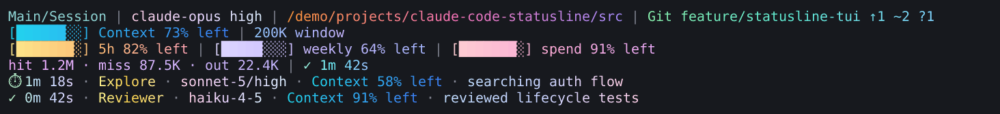
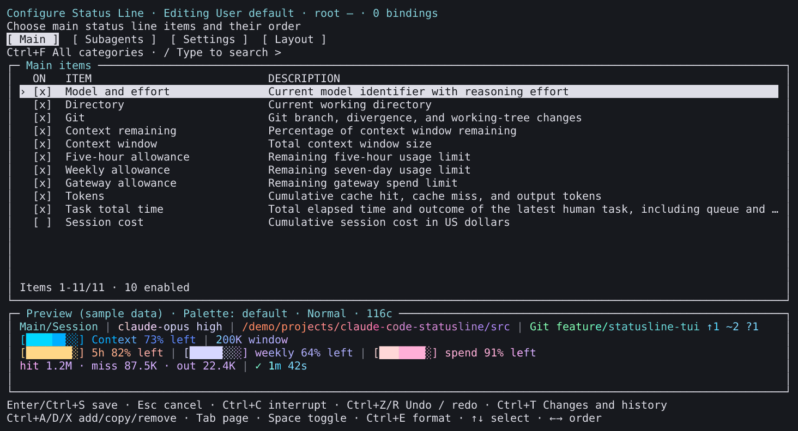

# Claude Code Statusline

**English** | [简体中文](README.zh-CN.md)

[](https://github.com/fbincon/claude-code-statusline/actions/workflows/ci.yml)
[](https://www.npmjs.com/package/@fbincon/claude-code-statusline) · [](LICENSE)

A configurable Claude Code status line for Linux, WSL, Windows and macOS. See model and reasoning effort, project, Git, context, usage and task timing at a glance. Configure the main line and individual subagent rows in the current Claude session, a terminal editor or the CLI.

[Demonstrations](docs/SHOWCASE.md) · [Quick installation](#quick-installation) · [Common configuration](#common-configuration) · [User guide](docs/USER_GUIDE.md) · [Troubleshooting](docs/USER_GUIDE.md#troubleshooting)

<a id="phase-4-in-stable-v150"></a>
<a id="phase-5-in-stable-v160"></a>
<a id="v161-clearer-external-tui-sections"></a>

## Features

- **Choose what to see:** 65 main metrics and 15 subagent metrics, plus text and flexible spacers. Search names, IDs and descriptions across twelve languages. [Metric definitions](docs/DISPLAY_ITEMS.md).
- **Compose a readable display:** independent component copies, linked groups, explicit rows, left/right layout, conditional visibility, colors, gradients and adaptive percentage indicators. [Composition](docs/COMPOSITION.md) · [Appearance](docs/APPEARANCE.md).
- **Start from a scheme:** eight complete display schemes and six original presets remain editable. Save named schemes, bind projects and reuse selected styles or whole groups. [Schemes](docs/SCHEMES.md) · [Project bindings](docs/PROFILES.md).
- **Review before saving:** sample scenarios, width previews, import differences, shared undo/redo and current-file comparison help inspect a draft. [Draft history and reuse](docs/DRAFT_HISTORY.md).
- **Follow tasks and agents:** separate session and per-agent metrics, task timing through agent work and main wrap-up, and a searchable task-evidence viewer. [Task details](docs/TASK_DETAILS.md).
- **Add explicit data sources:** local JSON, GitHub checks and command values, with separately reviewed activation, refresh and optional links. [Extensions](docs/EXTENSIONS.md).
- **Choose interface and output languages independently:** English, 简体中文, 繁體中文（台灣）, 繁體中文（香港）, 日本語, 한국어, Español, Français, Deutsch, Português (Brasil), Русский and Bahasa Indonesia.
- **Diagnose and recover:** inspect supplied input, review package changes and restore compatible configuration backups explicitly. [Input diagnosis](docs/DIAGNOSTICS.md) · [Package management](docs/PACKAGE_MANAGEMENT.md).

Rendering reads Claude Code input and local state without network requests or model tokens. Optional source refresh is separate; the question-and-answer wizard uses Claude model turns. Missing observations remain distinguishable from zero.

Available components do not guarantee available data. Host fields depend on Claude Code's payload; Git metrics need local Git and a repository; subagent rows need a compatible host and task data. Native timing/live metrics require compatible, explicitly enabled collection. GitHub and command values need a registered, reviewed, enabled and bound source, followed by a successful refresh. [Availability and freshness](docs/DISPLAY_ITEMS.md#availability-and-freshness) · [Source setup](docs/EXTENSIONS.md).

<a id="界面预览"></a>

## Screenshots

The daily development scene uses classic separators and distinct foreground gradients. [Reproduce the demonstrations](docs/SHOWCASE.md) · [Capture sources](docs/images/showcase/README.md).





The clip copies a metric, then shows Undo, Redo, Save and reopening the editor. These demonstrations use v3.16.0; later versions can adjust interaction details. Follow the [current user guide](docs/USER_GUIDE.md) for current controls.

<a id="支持范围"></a>

## Supported platforms

| Platform | Supported environment |
| --- | --- |
| Linux / WSL | Node 22.x or 24.x, x64 |
| Windows 10/11 | Node 22.x or 24.x, x64 |
| macOS 14+ | Node 22.x or 24.x, Intel / Apple Silicon |

Windows ARM devices use x64 Node under emulation; native Windows ARM64 and 32-bit runtimes are outside the support contract. Git fields require Git. Claude Code requirements vary by feature: subagent rows 2.1.205+ (per-task effort 2.1.214+), local slash arguments/external entry 2.1.258+, in-session editor 2.1.287+, native timing/live metrics 2.1.289+. [Requirements and limitations](docs/USER_GUIDE.md#requirements).

<a id="install-current-source"></a>
<a id="install-from-a-release-recommended"></a>
<a id="install-source-at-a-fixed-tag"></a>
<a id="从-release-安装推荐"></a>
<a id="从固定标签源码安装"></a>
<a id="从当前源码安装"></a>
<a id="快速安装"></a>
<a id="接入-claude-code"></a>

## Quick installation

Install Node 22.x or 24.x with npm and Claude Code CLI. The package bundles its supported native dependencies and needs no Python or compiler.

### Install the package

In an interactive terminal, `npx @fbincon/claude-code-statusline` reviews a persistent installation before opening setup. Alternatively, install the package explicitly:

```text
npm install --global --ignore-scripts @fbincon/claude-code-statusline
```

### Integrate with Claude Code

Ensure the npm command directory is on PATH, then run:

```text
claude-statusline --version
claude-statusline setup --dry-run
claude-statusline setup
claude-statusline doctor
```

On Windows, use `claude-statusline.cmd`, or invoke the installed JavaScript entry with Node. Restart Claude Code in a trusted terminal after integration. Package installation, display Save and Claude integration are separate stages; setup reports partial completion if a later stage fails.

Both editors default on for compatible hosts and preserve saved choices. Native timing and advanced live metrics require explicit opt-in. See [first-use setup](docs/SETUP.md), [offline/fixed-version installation](docs/USER_GUIDE.md#installation-and-integration), [conflict handling](docs/USER_GUIDE.md#handle-an-existing-status-line-or-skill-with-the-same-name) and [Python migration](docs/USER_GUIDE.md#migrate-from-python).

<a id="常用配置"></a>

## Common configuration

<a id="v130a2-external-tui-and-in-session-client"></a>

| Entry point | Use | Guide |
| --- | --- | --- |
| <a id="in-session-tui"></a><a id="native-configuration-editor"></a>`/statusline-configure-native` | Edit in the current Claude session | [In-session editor](docs/USER_GUIDE.md#native-configuration-editor) |
| <a id="external-tui"></a>`/statusline-configure` | Launch a supported external terminal from Claude Code | [External launcher](docs/USER_GUIDE.md#external-terminal-statusline-configure) |
| <a id="external-and-standalone-terminal-tui"></a>`claude-statusline configure` | Edit in the current terminal, including SSH | [Standalone editor](docs/USER_GUIDE.md#standalone-interactive-tui) |
| `/statusline-config` | Use the Claude wizard or run supported argument commands locally | [Question-and-answer wizard](docs/USER_GUIDE.md#statusline-config-wizard) |
| `claude-statusline config ...` | Inspect settings or set exact values from scripts | [CLI configuration recipes](docs/USER_GUIDE.md#configuration-recipes) |

Click the Client region once before using the keyboard in the in-session editor. In either editor, **Ctrl+P** opens Quick setup to select a scheme and preview the draft. Save applies the draft to the displayed user, profile or project. [Quick setup](docs/USER_GUIDE.md#quick-setup-text-editing-and-explanation) · [All schemes](docs/SCHEMES.md).

### Language settings

<a id="interface-language"></a>

Set the shared interface preference or use `--language` for one invocation.

```text
claude-statusline config language set zh-CN
claude-statusline --language en configure
```

The interface preference saves immediately and survives cancellation of display edits. [Interface language](docs/USER_GUIDE.md#interface-language).

<a id="statusline-language"></a>

Set the statusline output language independently.

```text
claude-statusline config set statusline-language zh-CN
```

In an editor, preview uses the draft language. Save the display draft to apply the language to the main line and subagent rows. [Statusline language](docs/USER_GUIDE.md#statusline-language).

### Start from a scheme

Use the daily development scheme with classic separators.

```text
claude-statusline config preset daily-development --dry-run
claude-statusline config preset daily-development
claude-statusline config set separator-style classic
```

Use the dry run to review the display selections and layout that the preset replaces.

<a id="升级与卸载"></a>
<a id="upgrade-to-v161"></a>

## Upgrading and uninstalling

Review and apply a package change, then restart Claude Code:

```text
claude-statusline update --check
claude-statusline update
claude-statusline doctor
```

[Package management](docs/PACKAGE_MANAGEMENT.md) explains exact versions, prefixes, rollback and separate configuration restoration. Remove Claude integration before uninstalling the package:

```text
claude-statusline uninstall --dry-run
claude-statusline uninstall
npm uninstall --global @fbincon/claude-code-statusline
```

Display settings and backups remain. [Uninstalling](docs/USER_GUIDE.md#uninstalling).

## Project structure

The TypeScript workspace separates pure rules (`packages/core`), platform effects (`packages/platform`), application services (`packages/cli`) and the terminal editor (`packages/tui`). `mods` contains the official-host integrations; `tools` contains generation, packaging and acceptance tooling. `archive/python` preserves the frozen historical implementation. [Architecture](docs/development/architecture.md) · [Development setup](docs/development/README.md).

<a id="文档与帮助"></a>

## Documentation and help

[Documentation index](docs/README.md) · [User guide](docs/USER_GUIDE.md) · [CLI reference](docs/reference/cli.md) · [Development guide](docs/development/README.md) · [Release notes](docs/releases/README.md) · [Changelog](CHANGELOG.md)

[GitHub Issues](https://github.com/fbincon/claude-code-statusline/issues) accepts reproducible bugs, questions and feature ideas. Include versions, steps and relevant diagnostics; remove private paths and session content.

## Contributing and security

See [Contributing](CONTRIBUTING.md) for development, translations and feedback. Report vulnerabilities privately through the [security policy](SECURITY.md). By participating, you agree to the [Code of Conduct](CODE_OF_CONDUCT.md).

<a id="许可证"></a>

## License

[MIT License](LICENSE). Copyright (c) 2026 [fbincon](https://github.com/fbincon).

Bundled Unicode data retains the [Unicode License v3](tools/unicode/UNICODE-LICENSE.txt) and the [wcwidth MIT notice](tools/unicode/WCWIDTH-LICENSE.txt).
