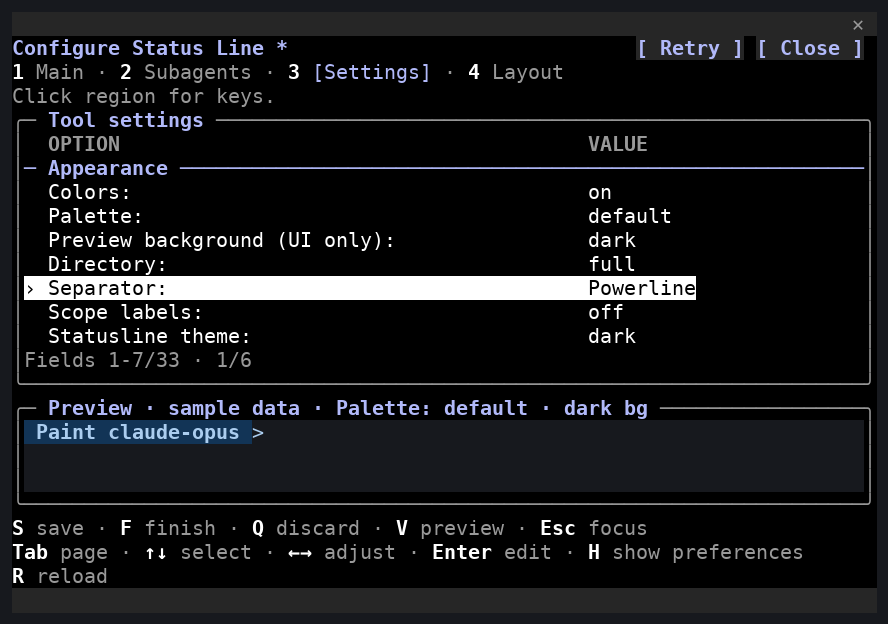
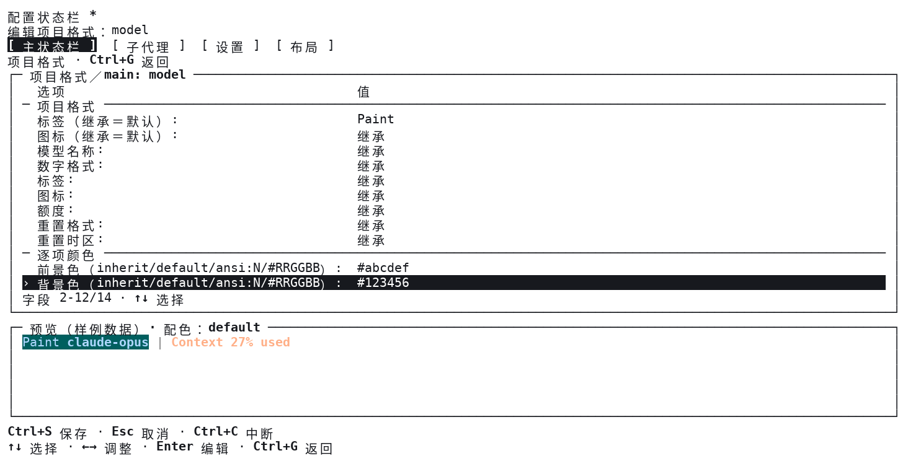

# 条件显示、颜色与 Powerline

[English](APPEARANCE.md) | **简体中文**

在“设置”页选择状态栏主题和分隔样式；按 Ctrl+E 打开显示项详情，编辑颜色及适用的条件规则。两个编辑器使用固定样例预览未保存草稿，保存后才生效，取消保留原配置。这些设置独立于 Claude 宿主主题、界面语言和原生预览背景。

## 条件显示

逐项设置不会自动启用显示项。请通过勾选或 `config enable context-used` 将它加入实际显示。

默认 `always` 不增加过滤，显示项仍沿用原来的数据缺失处理。条件在格式化和布局之前使用原始观测判断，因此百分比四舍五入、中文标签和数字缩写不会改变结果。隐藏后不残留分隔符或空行。

| 规则 | 支持的显示项 | 含义 |
| --- | --- | --- |
| `git-dirty` | 主状态栏 `git`、`git-changes` | 暂存、未暂存、冲突和未跟踪计数均确认是零时隐藏；复合 `git` 还要求领先／落后均为零且无上游丢失提示。Git 错误保留。 |
| `nonzero` | 主状态栏 `active-agents`、`task-progress` | 仅在完整有效观测确认零代理或空列表时隐藏；非空但全部完成的任务列表仍显示。 |
| `used-at-least` | 主状态栏 `context-used`、`context-remaining`、`five-hour-limit`、`weekly-limit`、`spend-limit`；子代理 `context-used`、`context-remaining` | 原始**已用**比例达到 `visibility-threshold` 时显示；阈值为 0–100 整数，初始值 70，不受显示“已用／剩余”的格式影响。 |

未知、过期、部分或不可用观测保留原来的表现，不视为零；到期额度仍沿用原来的省略规则。条件不会启用实时采集或增加采集器。可见性阈值与警告／危险颜色阈值相互独立。

```text
claude-statusline config item main git visibility git-dirty
claude-statusline config item main active-agents visibility nonzero
claude-statusline config item main task-progress visibility nonzero
claude-statusline config item main context-used visibility-threshold 80
claude-statusline config item main context-used visibility used-at-least
claude-statusline config item subagent context-remaining visibility used-at-least
claude-statusline config item main git visibility always
```

## 主题与逐项颜色

主题保留项目选择、顺序、格式、布局和采集偏好，切换主题也保留逐项覆盖。四种主题 ID 为 `classic`（既有外观）、`dark`（深色）、`light`（浅色）和 `terminal`（终端 ANSI 色槽），分别提供普通显示和 Powerline 颜色角色。主题不会修改终端背景或安装字体。

```text
claude-statusline config set theme light
claude-statusline config item main model foreground '#205727'
claude-statusline config item main model background 'ansi:254'
claude-statusline config item subagent name foreground default
claude-statusline config item main model foreground inherit
claude-statusline config item main model background inherit
```

颜色支持 `inherit`、`default`、`ansi:N`（0–255）和六位 `#RRGGBB`；在 shell 中为十六进制颜色加引号。`inherit` 继承显示项的主题／语义色，`default` 明确恢复终端前景／背景，包括 Powerline 色块内部。JSON 用 `null` 保存继承，其余值为字符串；RGB 文本统一转成小写。

启用阈值变色时，警告／危险前景色覆盖逐项前景色，逐项背景保持。沿用 `threshold-colors`、`warning-threshold` 和 `critical-threshold` 控制这一行为。关闭颜色会同时关闭前景与背景；`palette ansi` 将自定义 RGB／扩展色量化为基础 ANSI 色槽，实际色槽颜色由终端决定。外部编辑器按终端报告的颜色能力适配预览。

## 基础 Powerline

```text
claude-statusline config set separator-style powerline
claude-statusline config set powerline-glyph ascii
claude-statusline config set powerline-glyph powerline
claude-statusline config set separator-style classic
```

Powerline 默认关闭，开启后默认使用 `>`。选择 `powerline` 字形时，前一背景明确且相邻背景不同时使用 U+E0B0，其他边界使用 `>`。请自行选择支持该字形的字体，或恢复 `ascii`；无色输出使用 ASCII。

每个可见显示项形成一个色块，复合项目保留内部内容。左右各一格内边距及分隔字符计入宽度；窄的显式行／子代理行先减少装饰，再按优先级适配和完整字素裁剪。自动行按色块换行，过长色块仅在完整字素边界拆分。行尾恢复样式，默认背景不会泄漏到后续内容。原有自动／显式布局和逐项宽度设置继续适用。

## 色块控制与跨行配色

两种编辑器的设置页与 CLI 共用以下选项。这些是 Powerline 的全局**色块内部**设置，Claude 宿主整体 `padding` 仍然独立。

| CLI 选项 | 可选值 | 默认 |
| --- | --- | --- |
| `powerline-padding` | `none`、`left`、`right`、`both`；选中侧各一个空格 | `both` |
| `powerline-separator` | `arrow`、`slash`、`bar`、`none` | `arrow` |
| `powerline-start-cap` | `on`、`off` | `off` |
| `powerline-end-cap` | `on`、`off` | `on` |
| `powerline-color-mode` | `semantic`、`continuous`、`restart` | `semantic` |

```sh
claude-statusline config set separator-style powerline
claude-statusline config set powerline-padding left
claude-statusline config set powerline-separator slash
claude-statusline config set powerline-start-cap on
claude-statusline config set powerline-end-cap off
claude-statusline config set powerline-color-mode continuous
```

`semantic` 保留按组件含义配色；`continuous` 将主题的六种颜色按可见色块跨实际输出行连续轮换；`restart` 每个实际输出行从第一种颜色重新开始。主栏与子代理栏独立计算。隐藏组件、范围标签和 spacer 不占颜色位置，重复实例各自算一个色块；spacer 两侧共享同一行序列。更改主题保留逐项颜色覆盖及阈值颜色优先级。如果轮换的继承背景与保留的前景相同（例如 ANSI 警告色碰到黄色背景），改用中性背景以保证文字可见；显式背景不变。

首尾装饰跟随分隔形状，首端反向。ASCII 使用 `>`／`<`、`/`／`\`、`|` 或无字形；Powerline 仅在合适的彩色边界使用箭头／斜线字形，否则用对应 ASCII。无色输出使用 ASCII 且不包含 ANSI 转义。字体支持由用户明确选择，不自动检测。

留白、分隔符与首尾装饰全部计入宽度。窄行先去掉留白，再去掉端饰，再按优先级移除组件或在完整字素边界截断剩余色块。自动换行使用同一套宽度计算。空行不输出装饰，彩色行末恢复终端样式。

## 配置兼容与恢复

显示 schema **16** 包含 `powerline` 对象，包含 `padding`、`separator`、`start_cap`、`end_cap`、`color_mode`。编辑器协议 **26** 传输完整草稿；运行协议 **3**、生命周期 **4**、portable 封装 **1**、UI 偏好 **1**、方案集合／导出 **1** 仍独立演进。

schema 1–15 只在内存中迁移；读取、预览、`setup --dry-run` 和 `install --dry-run` 保留原始字节。明确保存显示或安装时先备份再写入 schema 16。缺失的 Powerline 控制默认为两侧留白、箭头分隔、无首饰、有尾饰和语义配色，保留原有 Powerline 输出。既有值保持原样，省略的渐变与对齐保持关闭。非法控制值与未来 schema 会被拒绝，导入审阅包含新字段。ASCII 状态表示也会保留任务／代理状态，不再将所有状态替换成相同通用图标。

降级前保存／导出当前配置，使用当前软件包的 `recover --restore-config TRANSACTION_ID` 显式恢复升级前的兼容显示备份，再按[版本管理指南](PACKAGE_MANAGEMENT.zh-CN.md)退回旧包并刷新匹配的接入资源。不要只修改 schema 数字，也不要期望旧软件保留新字段。恢复操作见[用户指南](USER_GUIDE.zh-CN.md)。

## 实际终端捕获示例

下图由安装包的实际终端输出和固定样例数据重建；[图片索引](images/README.zh-CN.md#conditional-appearance-captures)记录来源。图片检查不代表真人平台验收。





逐项外观设置作用于实例，复制后可独立修改。文本与留白的规则见[组件组合](COMPOSITION.zh-CN.md)。

## 图形指标

在任一编辑器的指标详情中，可为上下文和额度实例选择**指标显示方式**、**短条宽度**和**短条字符**。默认仍为数字；短条宽度为 4–20 格，默认 8 格。自动字符随 ASCII 图标设置使用 ASCII，否则使用 Unicode；不支持方块字符的终端可明确选择 `ascii`，无需颜色。

```bash
claude-statusline config instance main set context-remaining presentation bar
claude-statusline config instance main set context-remaining bar-width 8
claude-statusline config instance main set context-remaining bar-style ascii
```

使用 `config instance main list` 查询已有实例 ID；`subagent` 同样支持这些选项。适用类型为 `context-used`、`context-remaining`，以及仅主行支持的 `five-hour-limit`、`weekly-limit`、`spend-limit`。额度遵循实例的已用/剩余选项。隐藏普通标签时仍保留方向和百分比；短条表示观测水平，不表示经过时间或预测。缺失、无效或过期输入不会伪造为零；仅填充限制在 100%，有效超限额度保留数值。宽度适配可能裁剪或省略整个表示。

复制、配置方案和导入导出保留显示选项，不启用任何采集或来源。保存并重开后恢复选项，取消保留原配置。参阅[交付与兼容记录](development/m4-m7-delivery.zh-CN.md)。

## 静态组件渐变

在任一编辑器中打开组件外观字段，选择**前景渐变**或 **Powerline 背景渐变**。左右键轮换 `off`、`ocean`（海洋）、`sunset`（落日）、`aurora`（极光）；Enter 可输入预设名或 2～5 个逗号分隔的 `#RRGGBB` 颜色。预设保存为展开后的颜色，导出配置不依赖后续预设变化。启用或关闭渐变都保留原有纯色配置。

```sh
claude-statusline config instance main set context-used foreground-gradient ocean
claude-statusline config instance main set context-used background-gradient '#112233,#445566,#778899'
claude-statusline config instance main set context-used foreground-gradient off
```

子代理实例与固定文本使用相同字段；spacer 不支持渐变。背景渐变在 Powerline 模式生效，不改变采集或外部来源权限。

使用等距色点进行 sRGB 通道线性插值。前景覆盖最终可见图标、标签和正文，背景覆盖拟合后的色块及 padding。裁剪或换行后，每个可见片段独立重新展开渐变；首末字素取端点色，只有一个字素时使用首色。按终端单元格定位，保持字素完整并保留链接。ANSI 调色板转换为可用颜色；无色输出保留纯文本。

告警与严重阈值前景优先于前景渐变。渐变背景采样色与文字色相同时使用中性背景。共享 Powerline 组由主实例决定整组背景，各成员前景独立，并保留成员未生效的背景设置。分隔符和端帽使用相邻色块最终边缘色，spacer 间隙保持终端默认背景。现有 semantic／continuous／restart 模式继续排列继承色，显式渐变在组件或色块内重新开始。

渐变从显示 schema 14／编辑器协议 23 引入；统一交付使用 schema 15／协议 24，保持既有默认行为。旧文件读取仅在内存迁移，保存才备份。主区／子代理选择性导入包含其组件渐变，仅全局导入不会修改渐变。方案复制与导出保留渐变，旧程序拒绝新 schema，不会静默删除选项。

渐变背景与 RGB 告警／严重前景的对比度低于 3:1 时，背景改用中性色，保留告警前景；ANSI 颜色由终端主题定义，槽位相同时同样保护。

## 可视选色与样例场景

在主题、前景、背景或渐变字段按 Enter 打开配色页，名称旁显示实际色块和适用背景提示。Enter 选择候选，Ctrl+S 应用到显示草稿，Esc 取消本页修改。自定义颜色保留 `inherit`、`default`、`ansi:N` 和 RGB 支持。渐变支持 2–5 个 RGB 色标、逐色修改、反转、增删色标及关闭，关闭不删除已存纯色。

新增主题为适合深底的 `ocean`、`ember`、`slate` 和适合浅底的 `blossom`；新增渐变为 `glacier`、`lagoon`、`flame`、`copper`、`steel`、`sage`、`petal`、`twilight`。终端背景继续独立设置。

设置页提供样例场景和预览宽度。Ctrl+V 切换十四个场景，Ctrl+W 切换可用／40／80／120 列，Ctrl+N 推进预览行。标题显示场景和实际宽度。这些选择仅保留在当前编辑会话，同样应用于候选预览和样例解释。样例不启动采集、命令或网络查询。

参见[实施与验证](development/appearance-preview-diagnosis.zh-CN.md)。
