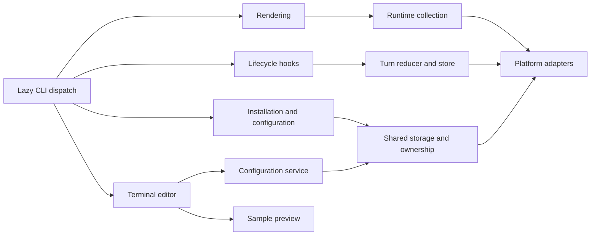

# Architecture and repository layout

**English** | [简体中文](architecture.zh-CN.md)

Current native capacity and recovery use bounded visible frames and add three-platform Claude 2.1.310 gates; see [implementation and acceptance](native-capacity.md).


[Extension implementation and validation](extensions.md) covers local JSON, GitHub, commands, links and shared component capabilities.

[Setup and complete appearance implementation](setup-appearance.md) covers first use, built-in schemes, schema 9, protocol 16 and their acceptance.

For named display schemes, user-side project bindings and read-only task inspection, see [profiles](../PROFILES.md) and [task details](../TASK_DETAILS.md).

For explicit real-input diagnosis and cache causes, see [input diagnosis](../DIAGNOSTICS.md) and [implementation and acceptance](real-input-diagnostics.md).

Shared cursor editing, scenario-based quick setup and the read-only `explain` operation are documented in [configuration experience and validation](configuration-experience.md).

Current timing provenance, exact replay deduplication and cache compatibility are documented in [post-migration repairs](post-migration-fixes.md).

The production package is TypeScript, retaining the existing CLI, configuration formats and storage locations. Implementation separates pure rules, platform effects, application services and terminal UI. The Python reference is frozen under `archive/python`; Python-specific sections below preserve historical architecture.

<a id="typescript-migration-workspace"></a>

## Current TypeScript workspace

TS-03 adds `packages/core` (pure configuration, protocol, localization, Unicode, rendering and runtime rules), `packages/platform` (Node/native I/O) and `packages/cli` (application services). TS-04 adds `packages/tui`, installed integration and durable recovery. The workspaces are private implementation packages bundled into the public npm product. The Python layout below is an archived comparison reference.

The canonical catalog is TypeScript data. Item IDs and preset descriptions are derived rather than separately edited in frontend contracts. Canonical languages live under `packages/core/resources/i18n`; the TypeScript generator emits Node and Mod resources, without regenerating the Python archive. Mod copies contain only supported pure modules, with host effects in their existing entries. See [TS-03 implementation and acceptance](typescript-migration/ts-03/README.md).

The migrated runtime uses `core/runtime/{tasks,live}`, `core/timing` and pure usage/Git parsers, coordinated by `cli/runtime`. Explicit `RuntimeContext`, `RuntimeIO` and `CommandRunner` boundaries supply clocks, process identity, private file publication and Git argv execution. Task history remains lifecycle schema 4 with its schema-1 compatibility mirror. Live writers acquire live then task locks; usage writers acquire cache then task locks. Task writers never acquire live/cache locks. Complete UTF-8 byte cursors, bounded histories and immutable frozen results survive mixed-version disk access. The development `runtime`/`hook` entry points do not switch installed commands or Mod bindings.

The TypeScript layout separates reusable rules, OS effects and application work:


Bare runtime protocol dispatch uses a read-only preference adapter without loading
management storage, display rules or UI locale data. Usage indexing retains an
at-most-32-MiB serialized overlay within one cache lock. Final pages are durably
published before the manifest and atomic state; overflow flushes use the same
publication adapter. Cleanup remains after the successful state commit. Persisted
formats and exact replay accounting are unchanged. See [PERF-01](performance/perf-01.md).

```text
packages/
  core/
    src/editor/                    Shared drafts, forms, search and response rules
    src/integration/               Pure executable/argv binding
    resources/i18n/                Canonical translations
  platform/
    src/terminal/                  Raw mode, VT input/output, launchers and bridge
    src/plugin-host.ts             Bounded official CLI transport
  cli/
    src/config/                    Configuration and UI protocol services
    src/integration/               Ownership, resources, installation and doctor
    src/recovery/                  Journals, file restore and official reconciliation
    resources/                     Canonical skill templates
  tui/
    src/                           External editor state, layout, drawing and session
    src/drawing/                   Bounded canvas/ANSI, presentation, shortcuts and pages
    test/                          Pure external-editor product regressions
tools/migration/ts-04/
  package.ts                       Private installed acceptance archive
  installed.ts                     Eight-target installed entry/editor/recovery gate
  official-installed.ts            Fixed-host installation gate
  host-smoke.ts                     Local real-host editor/runtime interaction
  test/                            Named responsibility and process/terminal tests
```

File publication records immutable before-images and durable checkpoints before
mutation. The shared installation lock protects file commits; an administration
lock serializes official integration phases. Explicit recovery verifies all
recorded states, reconciles uncertain host outcomes and preserves plugin opt-outs.
See [recovery](typescript-migration/ts-04/recovery.md) and
[installed acceptance](typescript-migration/ts-04/candidate.md).

## Current application services

The development CLI binds filesystem transactions and host identity through `ConfigurationService`/`Storage`. Its private ESM entry is `packages/cli/src/entry.ts`; configuration and protocol code reside under `config/` and `ui/`. The `render`, `render-subagents`, `hook` and `slash-hook` fast dispatches precede management-resource imports. Explicit `LaunchSpec` prefixes distinguish the TypeScript development backend from installed renderers.

`core/rendering` owns main/subagent composition, formatting, styles, Powerline and deterministic previews. `RenderEnvironment` supplies selected-language presentation and synchronous observation interfaces; `cli/rendering/environment.ts` imports selected collectors and connects runtime services. A frame caches each source and raw task snapshot before independently formatting repeated instances. `platform/presentation.ts` supplies lexical paths, local/UTC dates and hostname. Preview adapters substitute every observation; they do not collect or write runtime evidence. `packages/tui` implements the external editor over the shared editor core and an injected protocol backend. `platform/terminal` owns raw mode, incremental UTF-8/VT input, bounded output, launcher selection and private request/result files; `cli/integration` connects these adapters and rechecks request revocation under the configuration lock. See [TS-04](typescript-migration/ts-04/README.md).

The internal usage/transcript JSON path preserves numeric lexemes and falls back to the exact parser for ordered numeric keys and legacy constants. Mutable ID dictionaries keep Python insertion order with bounded deletion cost; native cache serialization retains Python spacing, ASCII escapes and numeric spellings. Public configuration/protocol parsing remains strict. These optimizations change no disk schema.

`cli/recovery` owns versioned file and official-operation journals. Configuration and installation services publish immutable before-images before mutations; incomplete journals block configuration writes until explicit recovery. Plugin refresh intent preserves manual disablement across uninstall/reinstall. Doctor only inspects. See [candidate recovery](typescript-migration/ts-04/recovery.md).

## Historical Python architecture

The original layout and implementation notes below are retained as historical controls from the [Python archive](../../archive/python/README.md). Python paths and migration-stage descriptions are not current main development instructions.

<details>
<summary>Expand historical layout and implementation notes</summary>

```text
src/claude_statusline/
  cli.py, __main__.py, _version.py   CLI dispatch and version
  config/                           Display/features, host settings, models,
                                    shared storage, transactions and commands
    instances.py, instance_commands.py Instance identity, migration and CLI
  i18n/                             Translation, presentation and registered locales and generated language modules
  rendering/                        Formatting, palette, layout, items,
                                    timer, main/subagent output and preview
    components.py                    Shared text/spacer fitting
  runtime/                          Paths, caches, registry, transcript,
                                    usage, Git and task lifecycle
    live/                           Independent timing/metrics observations
    timing/                         Immutable pause/resume clock and samples
    tasks/                          Task ownership, lifecycle, indexed evidence,
                                    native adapter, collection and locked store
    turns/                          Compatibility aliases to tasks/
  integration/                      Ownership, capabilities, resources,
                                    installation plan/commit, doctor,
                                    hooks, launcher and result bridge
  ui/                               External terminal editor and JSON backend
    models.py                       Terminal bounds, outcomes and stable field keys
    editor.py, forms.py              Draft state, grouped fields and pure edits
    layout.py                       Panel geometry and grouped viewport budgets
    theme.py                         Terminal-default styles and preview color pairs
    drawing.py, keys.py              Terminal drawing and keyboard dispatch
    session.py                      Terminal lifecycle, saves/cancel and file effects
    protocol.py, contracts.py        JSON backend and generated wire contracts
  platforms/                        OS detection, files, processes, clocks
                                    and the Terminal.app adapter
  resources/                        Bundled configuration skill templates
  *.py                              Legacy compatibility entry points

tests/{config,i18n,rendering,runtime,integration,ui,platforms}/
tests/support.py                    Stable source locations for subprocess tests
tools/                              Validation and opt-in acceptance commands
docs/development/                   Architecture, testing and timer contracts
```

## Dependencies and boundaries

The bundled TypeScript Client editor lives in `mods/statusline-native`, split into a statically inspectable host entry, pure draft and host-row logic, strict protocol bridge, generated contracts, page rendering and official tests. Python remains the configuration/rendering owner. Source distributions retain Mod development files; `src/build_native.py` copies only runtime manifests/modules into the wheel, with a generated hash/version/protocol inventory. The installer owns a local directory marketplace and uses official plugin commands, separately from its compatibility file transaction. See [native integration](native.md).

`config.catalog` defines scoped items and derived legacy views. `ui.contracts` defines the generated frontend wire types, `ui.protocol` owns JSON describe/read/preview/apply transport and `rendering.spans` converts production samples to drawable output. `config.revisions` supplies the installation-aware semantic revision for locked reads and shared JSON/curses saves. Apply reuses the configuration service transaction and returns its committed snapshot. See [shared contracts](contracts.md).

Platform adapters provide locking, atomic writes, process identity and suspend-aware clocks. Runtime collectors use those adapters; renderers consume collected data and display configuration. UI drafts save through the configuration service. Installation and configuration share the same storage lock and ownership helpers, preserving rollback and semantic conflict detection.



`render`, `render-subagents` and `hook` keep terminal editors and launchers out of their startup paths. Package initializers do not eagerly import the subsystems. Optional frontend imports remain at their use sites; sample preview uses fixed data without transcript/Git collection or persistence.

The main renderer reads official JSON on stdin and writes formatted text. The subagent renderer writes NDJSON with the existing `id`/`content` protocol. Hooks remain silent and successful when input or state is unavailable. Administrative command errors continue to use stderr and existing exit codes.

## Compatibility and resources

Original modules such as `claude_statusline.statusline`, `turn_state`, `installer`, `interactive_config` and `_platform` forward attribute reads to canonical implementations. Function, exception and model identities are shared; there is no second lifecycle store or transaction implementation. Existing module execution paths, including `python -m claude_statusline.macos_terminal`, remain usable.

Tests patch the canonical module that owns a function or constant. Assigning private globals on a compatibility module is not a configuration interface; use the documented environment variables for runtime locations.

Resources continue to load through `importlib.resources` from `claude_statusline/resources`. Terminal child processes locate Python through the root package rather than assumptions about a moved adapter's parent directories.

## Persistence

Current display schema v8 evolves independently from feature schema v1, the schema-1 runtime mirror and lifecycle schema v4; historical display v1–v7 is normalized in memory until saving. Optional `duration_source` distinguishes frozen task elapsed time from legacy native evidence; new native turn duration is stored separately. Optional agent history, continuation prompt aliases and pending reports preserve a human task across host-generated result notifications. They remain bounded and do not change configuration formats. Timing transcript scan version 6 rechecks old caches without resetting cumulative usage.

Keep local planning archives and raw acceptance records out of distributions. Public planning documents are maintained under `docs/development/`. Release archives originate from a fixed verified commit; package inspection checks all canonical Python modules, compatibility entry points, resources, tests, tools and bilingual documents.

See [testing](testing.md), the [timer contract](timer.md) and the [release guide](../RELEASING.md).

## Native editor structure

TS-04 makes `packages/core/src/editor` the canonical source of reusable editor and response-validation rules. `tools/generation/resources.ts` generates matching self-contained Mod modules. The pure `core/integration/binding` module supplies executable/argv selection for Node and both Mods; executable overrides discard the entire stored prefix. Host and Client adapters remain separate.

`ui/components/` holds shared sections: `section.ts` paints themed frame edges and `preview.ts` draws terminal-default samples independently of the host theme. `ui/layout.ts` owns the cell budget.

The sole editor Mod source remains `mods/statusline-native`. Host APIs stay in `hooks/register.ts`, draft/numeric rules in `lib/editor/`, validated batches/keys/settings in `lib/client/`, and bounded presentation projection in `lib/session.ts`. `ui/frame.ts` materializes the flat private presentation contract and checks output budgets. `ui/client/` owns Client input/drawing, `ui/components/` reusable sections, and `ui/layout.ts` the body budget. Tests mirror backend, client, editor, integration and UI.

The external `/statusline-configure` Python curses UI/platform launcher remains separate. Mod registers only `/statusline-configure-native`. Both can install/open together and use the same configuration service, revision checks and transaction lock. Client neither accesses files nor starts processes: cumulative ordered messages reach the host, detached visible frames isolate recursive host freezing, and sequence acknowledgements/deduplication plus epochs reject repeated/late input. Recursive packaging includes Client modules and excludes tests, host declarations, dependencies and raw validation reports.

config.editor_defaults shares stable editor defaults while each preference stays independent and explicit flags win. Installation, slash execution and doctor agree on external defaults: absence defaults on and explicit false persists off. Host thresholds are 2.1.258 external and 2.1.287 Client; unsupported/unknown versions suspend independently. Verified owned plugins suspend through locked, backed-up settings/owner transactions with rollback, without newer host APIs; only tool suspension automatically restores after compatibility returns.

## Independent display metrics

`rendering.metrics` owns strict numeric/context parsing, reset countdowns and session component formatting. The main render state shares a raw integer usage snapshot without additional I/O, captures one clock per refresh and memoizes live collectors; deterministic previews supply a fixed clock and sample values. Scoped catalog additions flow through generated contracts, both editors and the wizard without a schema/protocol change. See [display metric definitions](../DISPLAY_ITEMS.md).

Usage state keeps optional input/output observation flags alongside the existing integer accounting. Usage scan version 3 recovers these flags once for older sessions, including nested agents, without re-adding collapsed message IDs. Sparse cost-state snapshots update only observed counters; each counter keeps its own main/subagent delta anchor. The formatted collector interface and timer lifecycle remain compatible.

## Phase 4 configuration boundaries

Python `config.formatting`, `advanced`, `presets`, `transfer` and `editor_fields` own format rules, pure draft edits, preset expansion, portable files and shared form descriptors. Display schema v8 and protocol v11 evolve independently from editor enablement, runtime mirrors and lifecycle state. Both editors save a complete draft through the existing configuration service; legacy commands retain advanced fields and explicit reset restores defaults.

Curses `ui.forms` and Client `lib/client/forms.ts` expose scoped formats, Layout fitting and global settings from the canonical descriptors. Native hooks alone perform backend/file effects; `lib/preferences.ts` owns actual-row descriptions and supported controls, with separate Claude API application. Production and sample rendering share formatting and explicit layout; lazy Git/transcript collection is retained. No Phase 5 runtime indicators are added.

## Independent runtime collection

The opt-in `mods/statusline-runtime` is separate from the Client editor. Both Mods use explicit identities in the shared owned-plugin installer and resource inventory. `runtime/live/` owns the strict runtime protocol, per-session locks, atomic observation state and bounded history; configuration transactions and `runtime/turns` remain separate. The collector publishes only metadata, keeps exact retry identities, renews its session binding after resumes and reports stale or incomplete evidence. See [live contracts](live.md).

## Phase 5 metric migration

Display schema v4 adds nullable `metrics.branch_diff_base_ref`; configuration protocol v3 preserves it across both editors, conflicts, previews and portable files. V1/v2/v3 reads have no write effects; a real save backs up and migrates. Runtime observation protocol v2 accepts v1 without execution coverage. Committed branch comparisons and frozen ended-agent durations are documented in [metric definitions](../DISPLAY_ITEMS.md).

## External editor structure (v1.6.1)

`ui.layout` computes geometry and grouped windows without terminal/file effects. Headings consume screen rows without becoming selectable fields. `ui.forms` reuses canonical descriptors, gives legacy/portable controls stable keys and groups, and projects a contiguous external display order. `ui.editor`/`ui.keys` dispatch by field identity; drawing owns terminal output. JSON descriptors, Client ordering and wire contracts remain compatible, independent of external presentation order.

Content and Preview use their actual inner widths; resizing preserves drafts and input buffers. Tests follow the existing UI/integration layout, and the standalone PTY helper lives under tools. Production rendering, installation, runtime observation and compatibility entry points retain their responsibilities.

## Task clock structure

The canonical task implementation lives in `runtime/tasks`: model, reducer, agents, native adaptation, incremental evidence, collection and read-only views each have one responsibility. `runtime/timing` contains the pure serializable clock. The former `runtime/turns` modules alias the canonical modules, preserving Python entry points, shared function identity and the existing on-disk location.

Runtime collection has two independent modes. Native timing defaults on for compatible installations; advanced metrics remain opt-in. Both consume bounded, deduplicated metadata. Only the canonical task store decides task outcomes; advanced views derive their ownership from explicit links and verified lifecycle evidence. Formatting does not mutate task state; collection/reconciliation happens before formatting. Display schema 5, configuration protocol 6, runtime protocol 2 and runtime preference schema 2 evolve separately.

## TUI layout and shortcuts

Client `ui/layout.ts` budgets content, Preview and two action rows from terminal dimensions. The shared section component paints its title on the frame edge, with a one-row heading in compact mode. `lib/editor/navigation.ts` packs actual fields and group headings into pages; drawing and page keys share that calculation. Stable field keys retain selection through resize and headings are nonselectable. Layout expands mode and all row boundaries before item fitting in main-line order; item details keep format and fitting groups contiguous.

Each editor has a pure shortcut-segment helper that fits complete key/action groups. Keys use the primary text color and bold weight; descriptions use regular readable text. Client follows the applied Claude theme; external curses chrome uses terminal defaults and reversed selection. `ui.theme` owns capability-aware foreground pairs on the terminal-default background. Preview fills, resets and uncolored spans use terminal defaults; sample colors follow the selected production palette, with default-color/monochrome/allocation fallbacks. Narrow viewports use shorter labels and omit incomplete groups. External forms retain the existing grouped scrolling window; h still unfolds host preferences with separate Apply. Drawing performs no file or host effects.

## Shared interface language

`config.ui_preferences` owns the independent schema-v1 preference transaction; `i18n` owns lazy resources, semantic messages and presentation metadata. Python JSON language files generate the native `lib/i18n/generated-locales.ts` resource, checked in CI and distribution inspection. CLI parsers and both editors pass explicit languages, retaining English diagnostics and canonical machine catalogs. Render/hook startup paths do not load interface resources or preferences.

External session effects and native host effects write language immediately after user selection, update the view only on success and preserve unsaved drafts. Curses repaints its physical screen; both renderers recalculate cell budgets with existing width/clip helpers. Semantic error metadata stays in the host; the Client receives visible text in the current language. Language never enters display revisions or portable payloads. See [translation contributions](i18n.md) and [preference protocol](contracts.md#ui-preference-and-message-operations).

## Independent statusline language

Display schema v8 and configuration protocol v12 carry `statusline_language` through complete drafts, revisions, previews and portable files. `i18n.statusline` reads a generated Python-only subset of the canonical JSON resources; normal render calls do not read UI preferences or parse UI JSON. Formatter boundaries localize complete phrases and known values while collection stores keep their original codes. Item-scoped prefix metadata separates labels from user data. Shared editor descriptors add a choice that stays in the display draft; UI language remains an immediate preference.

## Component instances and layout

`config/instances.py` owns identity, legacy mapping and pure draft edits; `instance_commands.py` provides the CLI. `rendering/components.py` fits text and one flexible spacer in main/subagent rows. Raw observations are reused within the frame and copies format independently. Native pure edits live in `lib/editor/instances.ts`; TypeScript generates the shared protocol. See [composition](../COMPOSITION.md) and [shared contracts](contracts.md).

</details>

[Source and package execution boundaries and additional acceptance](source-command-package-management.md) document protocol 28, separate command approval, retained controls and protected cleanup.
