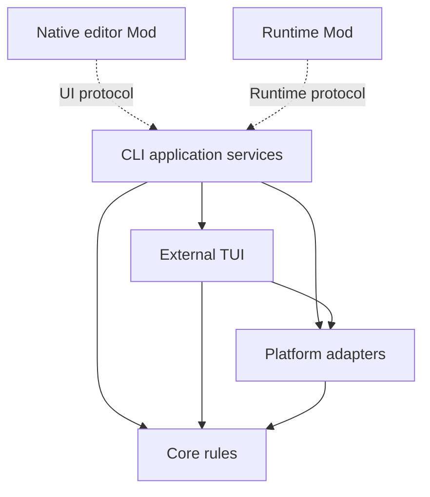

# Architecture and repository layout

**English** | [简体中文](architecture.zh-CN.md)

The product is a TypeScript/Node application. Pure rules live in core, OS effects in platform, application orchestration in CLI, and external terminal interaction in TUI. Native and runtime Mods adapt the official host and call the backend through separate JSON protocols.

## Architecture overview

Solid arrows show workspace dependencies; dashed arrows show backend process calls. TUI receives an injected backend rather than importing CLI services. Mods also contain generated copies of supported pure core modules, with host effects in their own entries.



<a id="typescript-migration-workspace"></a>

## Current TypeScript workspace

The private workspaces are bundled into the public npm product. Their layout separates reusable rules, OS effects and application work:

```text
packages/
  core/src/                       Configuration, contracts, editor, rendering and runtime rules
  core/resources/i18n/            Canonical translations
  platform/src/                   Files, processes, locking, host transport and terminals
  cli/src/                        Commands and application services
  cli/resources/                  Canonical skill templates
  tui/src/                        External editor state, layout, drawing and session
mods/
  statusline-native/              Official-host editor and generated pure resources
  statusline-runtime/             Official-host observations and lifecycle integration
tools/
  generation/                    Resource generation
  acceptance/                    Installed, terminal and host validation
  migration/                     Migration and historical comparison tooling
archive/python/                  Frozen implementation and comparison evidence
```

The canonical catalog is TypeScript data. Item IDs and preset descriptions are derived rather than separately edited in frontend contracts. Canonical languages live under `packages/core/resources/i18n`; the TypeScript generator emits Node and Mod resources without regenerating the Python archive.

<a id="current-application-services"></a>

## Runtime and data flow

### Command dispatch and rendering

The private ESM entry is `packages/cli/src/entry.ts`. Configuration and protocol services reside under `config/` and `ui/`. The `render`, `render-subagents`, `hook` and `slash-hook` fast dispatches precede management-resource imports. Bare runtime protocol dispatch uses a read-only preference adapter without loading management storage, display rules or UI locale data. Explicit `LaunchSpec` prefixes distinguish the development backend from installed renderers.

`core/rendering` owns main/subagent composition, formatting, styles, Powerline and deterministic previews. `RenderEnvironment` supplies selected-language presentation and synchronous observation interfaces; `cli/rendering/environment.ts` imports selected collectors and connects runtime services. A frame caches each source and raw task snapshot before independently formatting repeated instances. `platform/presentation.ts` supplies lexical paths, local/UTC dates and hostname. Preview adapters substitute every observation; they do not collect or write runtime evidence.

### Collection, timing and usage

`core/runtime/{tasks,live}`, `core/timing` and pure usage/Git parsers are coordinated by `cli/runtime`. Explicit `RuntimeContext`, `RuntimeIO` and `CommandRunner` boundaries supply clocks, process identity, private file publication and Git argv execution. Task history uses lifecycle schema 4 with its schema-1 compatibility mirror. Live writers acquire live then task locks; usage writers acquire cache then task locks. Task writers never acquire live/cache locks. Complete UTF-8 byte cursors, bounded histories and immutable frozen results survive mixed-version disk access. Development `runtime`/`hook` entry points do not switch installed commands or Mod bindings.

Usage indexing retains an at-most-32-MiB serialized overlay within one cache lock. Final pages are durably published before the manifest and atomic state; overflow flushes use the same publication adapter. Cleanup follows the successful state commit. The internal usage/transcript JSON path preserves numeric lexemes and falls back to the exact parser for ordered numeric keys and legacy constants. Mutable ID dictionaries keep Python insertion order with bounded deletion cost; native cache serialization retains Python spacing, ASCII escapes and numeric spellings. Public configuration/protocol parsing remains strict. These optimizations change no disk schema; the original performance evidence is in [PERF-01](history/performance/perf-01.md).

## Interfaces and persistence

`ConfigurationService`/`Storage` binds filesystem transactions and host identity. The editor UI protocol and runtime observation protocol evolve independently; the [CLI reference](../reference/cli.md#protocol-and-schema-versions) owns current versions and read ranges, while [shared contracts](contracts.md) owns operations and error behavior.

File publication records immutable before-images and durable checkpoints before mutation. The shared installation lock protects file commits; an administration lock serializes official integration phases. `cli/recovery` owns versioned file and official-operation journals. Incomplete journals block configuration writes until explicit recovery. Recovery verifies recorded states, reconciles uncertain host outcomes and preserves plugin opt-outs. Durable refresh intent retains manual disablement across uninstall/reinstall. Doctor only inspects. See [recovery](typescript-migration/ts-04/recovery.md) and [installed acceptance](typescript-migration/ts-04/candidate.md).

## Platform and host integration

`packages/tui` implements the external editor over the shared editor core and an injected protocol backend. `platform/terminal` owns raw mode, incremental UTF-8/VT input, bounded output, launcher selection and private request/result files. `cli/integration` connects these adapters and rechecks request revocation under the configuration lock.

The Native editor uses bounded visible frames and capacity/recovery handling for official-host panes. Runtime collection is independent of editor enablement. Host-specific capability and acceptance limits belong to the linked technical guides, rather than being inferred from workspace support.

## Implementation references

| Topic | Guide |
| --- | --- |
| Native editor and bounded presentation | [Native integration](native.md) · [Capacity and recovery](native-capacity.md) |
| Rendering, task timing and live collection | [Rendering](rendering.md) · [Timer](timer.md) · [Live metrics](live.md) |
| Sources, commands and links | [Extension implementation and validation](extensions.md) · [Source lifecycle and references](source-command-package-management.md#source-lifecycle-and-references) |
| Package execution and recovery | [Safe package handoff](source-command-package-management.md#safe-package-handoff) |
| Setup, editing and explanation | [Setup and complete appearance](setup-appearance.md) · [Configuration experience](configuration-experience.md) |
| Profiles, projects and tasks | [Implementation](profiles-projects-tasks.md) · [Profile guide](../PROFILES.md) · [Task details](../TASK_DETAILS.md) |
| Supplied-input diagnosis | [User guide](../DIAGNOSTICS.md) · [Implementation and acceptance](real-input-diagnostics.md) |

## Migration references

TS-03 introduced core, platform and CLI; TS-04 added TUI, installed integration and durable recovery. Their original implementation, acceptance entry points under `tools/migration/ts-04/`, and evidence remain in [TS-03](typescript-migration/ts-03/README.md) and [TS-04](typescript-migration/ts-04/README.md). The setup guide records the original schema 9/protocol 16 delivery, rather than the current interface versions. The [v3.1.3 repair record](history/migration/post-migration-fixes.md) preserves timing provenance, exact replay deduplication and cache compatibility changes.

## Historical Python architecture

See the [historical Python architecture](history/python-implementation.md#python-architecture) for the original layout, version constraints and implementation details. These links preserve the previous section anchors.

- <a id="dependencies-and-boundaries"></a>[Dependencies and boundaries](history/python-implementation.md#dependencies-and-boundaries)
- <a id="compatibility-and-resources"></a>[Compatibility and resources](history/python-implementation.md#compatibility-and-resources)
- <a id="persistence"></a>[Persistence](history/python-implementation.md#persistence)
- <a id="native-editor-structure"></a>[Native editor structure](history/python-implementation.md#native-editor-structure)
- <a id="independent-display-metrics"></a>[Independent display metrics](history/python-implementation.md#independent-display-metrics)
- <a id="phase-4-configuration-boundaries"></a>[Phase 4 configuration boundaries](history/python-implementation.md#phase-4-configuration-boundaries)
- <a id="independent-runtime-collection"></a>[Independent runtime collection](history/python-implementation.md#independent-runtime-collection)
- <a id="phase-5-metric-migration"></a>[Phase 5 metric migration](history/python-implementation.md#phase-5-metric-migration)
- <a id="external-editor-structure-v161"></a>[External editor structure (v1.6.1)](history/python-implementation.md#external-editor-structure-v161)
- <a id="task-clock-structure"></a>[Task clock structure](history/python-implementation.md#task-clock-structure)
- <a id="tui-layout-and-shortcuts"></a>[TUI layout and shortcuts](history/python-implementation.md#tui-layout-and-shortcuts)
- <a id="shared-interface-language"></a>[Shared interface language](history/python-implementation.md#shared-interface-language)
- <a id="independent-statusline-language"></a>[Independent statusline language](history/python-implementation.md#independent-statusline-language)
- <a id="component-instances-and-layout"></a>[Component instances and layout](history/python-implementation.md#python-architecture-component-instances-and-layout)
