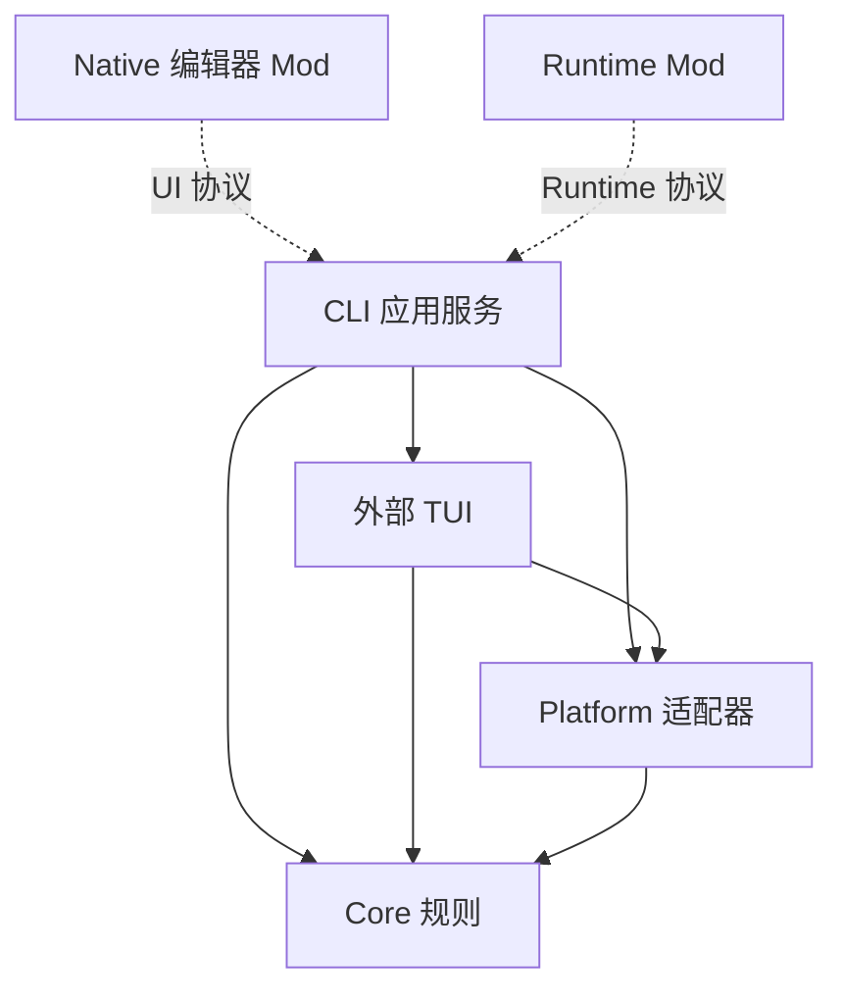

# 架构与仓库布局

[English](architecture.md) | **简体中文**

产品是 TypeScript／Node 应用。core 负责纯规则，platform 负责系统副作用，CLI 编排应用服务，TUI 负责外部终端交互。Native 和 runtime Mod 适配官方宿主，分别通过 JSON 协议调用后端。

## 架构概览

实线表示 workspace 依赖，虚线表示后端进程调用。TUI 接收注入的后端，不导入 CLI 服务。Mod 还包含由 core 生成的受支持纯模块副本，宿主副作用保留在各自入口。



<a id="typescript-迁移-workspace"></a>

## 当前 TypeScript workspace

私有 workspace 打包到公开 npm 成品中，布局将复用规则、系统操作及应用编排分开：

```text
packages/
  core/src/                       配置、契约、编辑、渲染及运行规则
  core/resources/i18n/            规范翻译资源
  platform/src/                   文件、进程、锁、宿主传输和终端
  cli/src/                        命令及应用服务
  cli/resources/                  规范技能模板
  tui/src/                        外部编辑器状态、布局、绘制及会话
mods/
  statusline-native/              官方宿主编辑器及生成的纯资源
  statusline-runtime/             官方宿主观测及生命周期集成
tools/
  generation/                    资源生成
  acceptance/                    安装、终端及宿主验收
  migration/                     迁移及历史比较工具
archive/python/                  冻结实现及比较证据
```

规范目录是 TypeScript 数据，项目 ID 和预设说明由其派生，不在前端契约中重复手改。规范语言资源位于 `packages/core/resources/i18n`，TypeScript 生成器统一输出 Node 和 Mod 资源，不重新生成 Python 归档。

<a id="当前应用服务"></a>

## 运行与数据流

### 命令分发与渲染

私有 ESM 入口为 `packages/cli/src/entry.ts`，配置及协议服务位于 `config/`、`ui/`。`render`、`render-subagents`、`hook`、`slash-hook` 的快速分发位于管理资源导入之前；独立 runtime 协议分发使用只读偏好适配器，不加载管理存储、显示规则及界面语言数据。完整 `LaunchSpec` 前缀区分开发后端与已安装渲染器。

`core/rendering` 负责主／子行组合、格式、样式、Powerline 和确定性预览。`RenderEnvironment` 提供选定语言与同步观测接口；`cli/rendering/environment.ts` 按组件需要导入采集器并连接运行服务。每帧缓存各来源和原始任务快照，重复实例分别格式化；`platform/presentation.ts` 提供词法路径、本地／UTC 日期和主机名。预览替换所有观测，不采集或写入运行证据。

### 采集、计时与用量

`core/runtime/{tasks,live}`、`core/timing` 和纯用量／Git 解析模块由 `cli/runtime` 编排。明确的 `RuntimeContext`、`RuntimeIO`、`CommandRunner` 边界提供时钟、进程身份、私有文件发布及 Git argv 执行。任务历史使用生命周期 schema 4 和 schema-1 兼容镜像；live 写入先取 live 锁再取 task 锁，用量写入先取 cache 锁再取 task 锁，任务写入不反向获取 live／cache 锁。完整 UTF-8 字节游标、有界历史和冻结结果兼容混合版本磁盘访问；开发用 `runtime`／`hook` 入口不切换已安装命令或 Mod 绑定。

用量索引在一次缓存锁内保留最多 32 MiB 序列化暂存，先持久化最终页，再发布 manifest 及原子状态；超出上限仍使用相同持久化适配器，清理在状态提交成功后进行。内部用量／transcript JSON 路径保留数值词法，遇到有序数字键或旧常量时回到精确解析器。可变 ID 字典以有界删除开销保持 Python 插入顺序；原生缓存序列化保持 Python 空格、ASCII 转义及数值拼写。公开配置／协议继续严格解析。这些优化不改变磁盘 schema，原始性能证据见 [PERF-01](history/performance/perf-01.zh-CN.md)。

## 接口与持久化

`ConfigurationService`／`Storage` 绑定文件事务和宿主身份。编辑器 UI 协议与 runtime 观测协议独立演进；当前版本与读取范围由 [CLI 参考](../reference/cli.zh-CN.md#协议与-schema-版本)维护，操作和错误行为由[共享契约](contracts.zh-CN.md)维护。

文件发布在修改前记录不可覆盖的原始快照与持久检查点。共同安装锁保护文件提交，管理锁串行化官方集成阶段。`cli/recovery` 维护带版本的文件与官方操作日志，未完成日志阻止配置写入，直到显式恢复。恢复核验记录状态、核对不明确的宿主结果并保留插件禁用偏好。持久刷新意图跨卸载／重装保留手动禁用；doctor 仅检查。参见[TS-04 历史恢复证据](typescript-migration/ts-04/recovery.zh-CN.md)和[TS-04 历史安装验收](typescript-migration/ts-04/candidate.zh-CN.md)；当前恢复行为由[共享契约](contracts.zh-CN.md#候选安装与恢复)规定。

## 平台与宿主集成

`packages/tui` 在共享编辑核心及可注入协议后端上实现外部编辑器。`platform/terminal` 负责 raw mode、增量 UTF-8／VT 输入、有界输出、启动器及私有请求／结果文件；`cli/integration` 连接适配层，并在配置锁内复核请求撤销。

Native 编辑器为官方宿主窗格提供有界可见帧及容量／恢复处理。Runtime 采集独立于编辑器启用状态。宿主特定能力和验收边界以关联技术指南为准，不能从 workspace 支持情况推断。

## 深入实现参考

| 主题 | 指南 |
| --- | --- |
| 原生编辑器与有界呈现 | [Native 集成](native.zh-CN.md) · [容量与恢复](native-capacity.zh-CN.md) |
| 渲染、任务计时与实时采集 | [渲染](rendering.zh-CN.md) · [计时](timer.zh-CN.md) · [实时指标](live.zh-CN.md) |
| 来源、命令和链接 | [扩展实现与验收](extensions.zh-CN.md) · [来源生命周期与引用](source-command-package-management.zh-CN.md#来源生命周期与引用) |
| 包执行与恢复 | [安全包交接](source-command-package-management.zh-CN.md#安全包交接) |
| 设置、编辑与解释 | [首次设置与完整外观](setup-appearance.zh-CN.md) · [配置体验](configuration-experience.zh-CN.md) |
| 方案、项目与任务 | [实现说明](profiles-projects-tasks.zh-CN.md) · [方案指南](../PROFILES.zh-CN.md) · [任务详情](../TASK_DETAILS.zh-CN.md) |
| 显式输入诊断 | [使用指南](../DIAGNOSTICS.zh-CN.md) · [实现与验收](real-input-diagnostics.zh-CN.md) |

## 迁移参考

TS-03 引入 core、platform 和 CLI；TS-04 加入 TUI、安装集成与持久恢复。原始实现、`tools/migration/ts-04/` 下的验收入口和证据分别保留在 [TS-03](typescript-migration/ts-03/README.zh-CN.md) 与 [TS-04](typescript-migration/ts-04/README.zh-CN.md)。首次设置指南记录原始 schema 9／协议 16 交付，不代表当前接口版本。[v3.1.3 修复记录](history/migration/post-migration-fixes.zh-CN.md)保留计时证据、精确重放去重及缓存兼容的改动。

## 历史 Python 架构

原始布局、版本约束与实现说明见[历史 Python 架构](history/python-implementation.zh-CN.md#python-architecture)。以下入口保留原章节的锚点。

- <a id="依赖与边界"></a>[依赖与边界](history/python-implementation.zh-CN.md#依赖与边界)
- <a id="兼容与资源"></a>[兼容与资源](history/python-implementation.zh-CN.md#兼容与资源)
- <a id="持久化"></a>[持久化](history/python-implementation.zh-CN.md#持久化)
- <a id="原生编辑器结构"></a>[原生编辑器结构](history/python-implementation.zh-CN.md#原生编辑器结构)
- <a id="独立显示指标"></a>[独立显示指标](history/python-implementation.zh-CN.md#独立显示指标)
- <a id="phase-4-配置边界"></a>[Phase 4 配置边界](history/python-implementation.zh-CN.md#phase-4-配置边界)
- <a id="独立运行采集"></a>[独立运行采集](history/python-implementation.zh-CN.md#独立运行采集)
- <a id="phase-5-指标迁移"></a>[Phase 5 指标迁移](history/python-implementation.zh-CN.md#phase-5-指标迁移)
- <a id="外部编辑器结构v161"></a>[外部编辑器结构（v1.6.1）](history/python-implementation.zh-CN.md#外部编辑器结构v161)
- <a id="任务时钟结构"></a>[任务时钟结构](history/python-implementation.zh-CN.md#任务时钟结构)
- <a id="tui-布局与快捷键"></a>[TUI 布局与快捷键](history/python-implementation.zh-CN.md#tui-布局与快捷键)
- <a id="共享界面语言"></a>[共享界面语言](history/python-implementation.zh-CN.md#共享界面语言)
- <a id="独立的状态栏语言"></a>[独立的状态栏语言](history/python-implementation.zh-CN.md#独立的状态栏语言)
- <a id="组件实例与布局"></a>[组件实例与布局](history/python-implementation.zh-CN.md#python-architecture-component-instances-and-layout)
