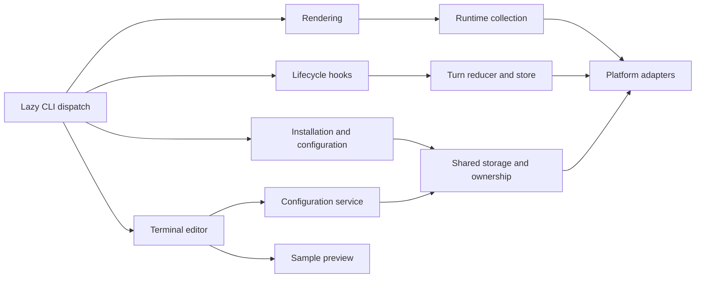

# Historical Python implementation notes

**English** | [简体中文](python-implementation.zh-CN.md)

These notes describe the final Python release, v2.0.0, before the TypeScript migration. See the [frozen Python archive](../../../archive/python/README.md) for its source and the [TypeScript architecture](../architecture.md) for current implementation details. The paths, locks and launch commands below apply to that historical implementation.

## Files and platform behavior

<a id="平台执行与文件安全"></a>
### Platform execution and file safety

<details>
<summary>Expand historical record for Platform execution and file safety</summary>

On Linux/macOS, the installer writes absolute executable paths with POSIX quoting into Claude Code settings. Windows writes command names executable through both Git Bash and PowerShell, requiring `claude-statusline.exe` on `PATH`:

```text
claude-statusline.exe render
claude-statusline.exe render-subagents
claude-statusline.exe hook
claude-statusline.exe slash-hook
```

The Windows skill uses `claude-statusline.exe config ...`, preauthorizing only `Bash(claude-statusline.exe config *)` and `PowerShell(claude-statusline.exe config *)`. Linux/macOS authorize only Bash commands for the installed absolute path. Claude Code prefers Git Bash for Windows status-line commands and falls back to PowerShell, so all four internal commands use bare `.exe` names rather than backslash-containing absolute paths that Git Bash would interpret as escapes. See [Claude Code's Windows status-line conventions](https://code.claude.com/docs/en/statusline).

NTFS `st_mode` on Windows is not reliable POSIX permission information; `doctor` reports mode checks as inapplicable. File safety relies on inherited Windows ACLs in the user's Claude configuration directory. Result bridging still rejects symlinks, junctions, other reparse points, paths outside the expected directory, nonregular files, and results above 16 KiB.

</details>

<a id="配置写入与并发"></a>
### Configuration writes and concurrency

<details>
<summary>Expand historical record for Configuration writes and concurrency</summary>

Configuration, token caches, Git caches, and per-turn state use same-directory temporary files, file `fsync`, and atomic replacement. Linux/macOS apply `0600/0700`, sync parent directories, and use `fcntl.flock`. Windows uses inherited user ACLs and `msvcrt` fixed-byte locks, with bounded retries for transient sharing violations/access denied. Concurrent configuration commands share one cross-platform lock to avoid lost updates.

If macOS parent-directory sync returns `EINVAL` or `ENOTSUP/EOPNOTSUPP`, file `fsync` and atomic replacement remain, and `doctor`/CI report degradation. Other I/O or permission errors propagate. No additional `F_FULLFSYNC` is used.

macOS session process identity uses `/bin/ps -o lstart= -p PID` with `LC_ALL=C` and `TZ=UTC`, preserving internal spaces. Matching sessions are filtered before process queries; a 1-second timeout or query failure makes the registry record untrusted. Timing uses integer conversion of LibSystem `mach_continuous_time()` and `mach_timebase_info()`, plus `kern.bootsessionuuid` for cross-process reboot detection. If any interface is unavailable, the whole group falls back to wall-clock time.

Global Enter calls the existing atomic configuration transaction once. No changes means no backup; changes use one backup, two-file writes, and rollback on failure. The TUI records a semantic baseline at startup and checks display, host, and installation ownership within the same installation lock before saving. External changes during editing are rejected before backup or writing. Unrelated `settings.json` changes do not conflict and are preserved by merging into the latest file under the lock.

</details>

## Editor and component behavior

<a id="实验启动器与结果回传"></a>
<a id="experimental-launchers-and-result-bridging"></a>
### External launchers and result bridging

<details>
<summary>Expand historical record for External launchers and result bridging</summary>

The external `/statusline-configure` is a terminal launcher and does not bypass hook terminal isolation. Claude Code 2.1.259 command hooks run in a new session without a controlling terminal: hooks and children cannot open `/dev/tty`, and `terminalSequence` cannot draw curses. The slash command therefore serves only as a local launcher for existing `claude-statusline configure` in another supported terminal. It reuses the existing state machine, sample preview, concurrency detection, and atomic save.

Linux chooses launchers in this order:

1. If `TMUX` and `TMUX_PANE` shaped as `%<digits>` are valid, `tmux` is executable, and a read-only preflight check resolves the pane in the current server within 2 seconds, open a `90% × 90%` popup titled `Configure Status Line` in the current client. tmux pauses underlying pane updates while the popup exists, and closes it automatically when the child exits.
2. If tmux is unavailable or preflight fails, but `DISPLAY`/`WAYLAND_DISPLAY` and executable `gnome-terminal` are available, open an active tab in the most recently used GNOME Terminal window. GNOME may create a window if none exists. `--wait` waits for the tab's TUI to exit.
3. If neither is available, block slash expansion without calling the model and suggest terminal `claude-statusline configure` or `/statusline-config`.

macOS prefers the same tmux path. Without a valid server/pane or after failed preflight, a read-only `launchctl print gui/<uid>` check with a 2-second limit verifies the local graphical session, alongside system Terminal.app and `open`. SSH does not launch desktop Terminal, and macOS never selects GNOME.

The Terminal path uses `/usr/bin/open -b com.apple.Terminal` to open a private `0700` `.command` file, which starts the current Python and the package's internal helper. Python, CLI, configuration directory, and working directory are absolute; PATH and package search paths are explicit, and all shell values are quoted. `open` returning success means only that the launch request was handled. A 30-second startup handshake verifies editor process identity, then the existing schema v1 result bridge waits for TUI completion. No AppleScript automation permission is required, and Terminal window preferences are not modified.

The editor periodically checks parent-call process identity, request file, and deadline, and rechecks them before saving under the configuration transaction lock. Window closure, interruption, parent-call exit, revocation, or timeout prevents further draft saves. Cleanup verifies PID and start identity and handles only this editor; after reading the result, it removes this call's script, request, handshake, and result files. Terminal's window closure or retention follows user preferences.

Windows does not probe tmux/GNOME. It starts an actual Python child with the current virtual environment's `sys.executable -m claude_statusline configure --config-dir ...` and [`CREATE_NEW_CONSOLE`](https://learn.microsoft.com/en-us/windows/console/creation-of-a-console), without redirecting stdin/stdout/stderr, so curses has a real console. The current system default terminal hosts it; Windows Terminal handles it naturally when set as default. The launcher retains the child handle, so window closure or abnormal exit immediately returns an error, and timeouts terminate and reap the child.

Only tmux popup resembles a popup in the same pane; GNOME uses a new tab. There are no automatic launchers for `x-terminal-emulator`, Konsole, Kitty, WezTerm, or iTerm2; use standalone `configure` there. Hook payload `cwd` is used only when it is an existing absolute directory, otherwise the user's home is used. Command arguments and cwd are never concatenated into unescaped shell text.

`/statusline-configure` accepts no arguments. `help`, `-h`, and `--help` return only `Usage: /statusline-configure`; other arguments are rejected. None of these argument cases starts a TUI, writes configuration, or calls the model.

Each call creates a random directory under `statusline_runtime/slash_tui/` in the Claude configuration directory. Linux/macOS verify directory `0700` and write results with `0600`; Windows does not interpret simulated POSIX mode. Result reads verify exact parent-child paths, regular files, and a 16 KiB limit, rejecting symlinks, junctions, and other reparse points throughout the path chain. Only the current call is cleaned up after reading. Hook-captured tmux/GNOME client stdout/stderr is length-limited; Terminal.app and Windows console TUIs use their own real terminal streams.

Claude's hook timeout is 600 seconds. The bridged TUI times out after 570 seconds without saving; the launcher waits at most 585 seconds, leaving time for validation and hook return. Saving, no changes, cancellation, signal interruption, timeout, and errors produce a short result in the original Claude conversation. Once tmux is chosen, failure inside its popup never starts another terminal.

If global `disableAllHooks` or similar settings prevent the local hook, the fallback skill explains that it did not run and suggests the standalone command or `/statusline-config`. It prohibits launching curses through both Bash and PowerShell. This exception may still use a very short model turn, which the plugin cannot avoid.

- [Rendering and Unicode contracts](../rendering.md)

</details>

### Component instances and layout

<details>
<summary>Expand historical record for Component instances and layout</summary>

`config/instances.py` owns identity, legacy mapping and pure draft edits; `instance_commands.py` provides the CLI. `rendering/components.py` fits text and one flexible spacer in main/subagent rows. Raw observations are reused within the frame and copies format independently. Native pure edits live in `lib/editor/instances.ts`; Python generates the protocol. See [composition](../../COMPOSITION.md) and [shared contracts](../contracts.md).

</details>

<a id="python-architecture"></a>

## Historical Python architecture

The layout and implementation details below describe released Python versions. See the [frozen Python archive](../../../archive/python/README.md) for the source.

### Source layout

<details>
<summary>View Source layout</summary>

```text
src/claude_statusline/
  cli.py, __main__.py, _version.py   CLI dispatch and version
  config/                           Display/features, host settings, models,
                                    shared storage, transactions and commands
    instances.py, instance_commands.py Instance identity, migration and CLI
  i18n/                             Translation, presentation and registered locales and generated language modules
  rendering/                        Formatting, palette, layout, items,
                                    timer, main/subagent output and preview
    components.py                    Shared text/spacer fitting
  runtime/                          Paths, caches, registry, transcript,
                                    usage, Git and task lifecycle
    live/                           Independent timing/metrics observations
    timing/                         Immutable pause/resume clock and samples
    tasks/                          Task ownership, lifecycle, indexed evidence,
                                    native adapter, collection and locked store
    turns/                          Compatibility aliases to tasks/
  integration/                      Ownership, capabilities, resources,
                                    installation plan/commit, doctor,
                                    hooks, launcher and result bridge
  ui/                               External terminal editor and JSON backend
    models.py                       Terminal bounds, outcomes and stable field keys
    editor.py, forms.py              Draft state, grouped fields and pure edits
    layout.py                       Panel geometry and grouped viewport budgets
    theme.py                         Terminal-default styles and preview color pairs
    drawing.py, keys.py              Terminal drawing and keyboard dispatch
    session.py                      Terminal lifecycle, saves/cancel and file effects
    protocol.py, contracts.py        JSON backend and generated wire contracts
  platforms/                        OS detection, files, processes, clocks
                                    and the Terminal.app adapter
  resources/                        Bundled configuration skill templates
  *.py                              Legacy compatibility entry points

tests/{config,i18n,rendering,runtime,integration,ui,platforms}/
tests/support.py                    Stable source locations for subprocess tests
tools/                              Validation and opt-in acceptance commands
docs/development/                   Architecture, testing and timer contracts
```

</details>

### Dependencies and boundaries

<details>
<summary>View Dependencies and boundaries</summary>

The bundled TypeScript Client editor lives in `mods/statusline-native`, split into a statically inspectable host entry, pure draft and host-row logic, strict protocol bridge, generated contracts, page rendering and official tests. Python remains the configuration/rendering owner. Source distributions retain Mod development files; `src/build_native.py` copies only runtime manifests/modules into the wheel, with a generated hash/version/protocol inventory. The installer owns a local directory marketplace and uses official plugin commands, separately from its compatibility file transaction. See [native integration](../native.md).

`config.catalog` defines scoped items and derived legacy views. `ui.contracts` defines the generated frontend wire types, `ui.protocol` owns JSON describe/read/preview/apply transport and `rendering.spans` converts production samples to drawable output. `config.revisions` supplies the installation-aware semantic revision for locked reads and shared JSON/curses saves. Apply reuses the configuration service transaction and returns its committed snapshot. See [shared contracts](../contracts.md).

Platform adapters provide locking, atomic writes, process identity and suspend-aware clocks. Runtime collectors use those adapters; renderers consume collected data and display configuration. UI drafts save through the configuration service. Installation and configuration share the same storage lock and ownership helpers, preserving rollback and semantic conflict detection.



`render`, `render-subagents` and `hook` keep terminal editors and launchers out of their startup paths. Package initializers do not eagerly import the subsystems. Optional frontend imports remain at their use sites; sample preview uses fixed data without transcript/Git collection or persistence.

The main renderer reads official JSON on stdin and writes formatted text. The subagent renderer writes NDJSON with the existing `id`/`content` protocol. Hooks remain silent and successful when input or state is unavailable. Administrative command errors continue to use stderr and existing exit codes.

</details>

### Compatibility and resources

<details>
<summary>View Compatibility and resources</summary>

Original modules such as `claude_statusline.statusline`, `turn_state`, `installer`, `interactive_config` and `_platform` forward attribute reads to canonical implementations. Function, exception and model identities are shared; there is no second lifecycle store or transaction implementation. Existing module execution paths, including `python -m claude_statusline.macos_terminal`, remain usable.

Tests patch the canonical module that owns a function or constant. Assigning private globals on a compatibility module is not a configuration interface; use the documented environment variables for runtime locations.

Resources continue to load through `importlib.resources` from `claude_statusline/resources`. Terminal child processes locate Python through the root package rather than assumptions about a moved adapter's parent directories.

</details>

### Persistence

<details>
<summary>View Persistence</summary>

The final Python release used display schema v8, which evolved independently from feature schema v1, the schema-1 runtime mirror and lifecycle schema v4; historical display v1–v7 is normalized in memory until saving. Optional `duration_source` distinguishes frozen task elapsed time from legacy native evidence; new native turn duration is stored separately. Optional agent history, continuation prompt aliases and pending reports preserve a human task across host-generated result notifications. They remain bounded and do not change configuration formats. Timing transcript scan version 6 rechecks old caches without resetting cumulative usage.

Keep local planning archives and raw acceptance records out of distributions. Public planning documents are maintained under `docs/development/`. Release archives originate from a fixed verified commit; package inspection checks all canonical Python modules, compatibility entry points, resources, tests, tools and bilingual documents.

See [testing](../testing.md), the [timer contract](../timer.md) and the [release guide](../../RELEASING.md).

</details>

### Native editor structure

<details>
<summary>View Native editor structure</summary>

TS-04 makes `packages/core/src/editor` the canonical source of reusable editor and response-validation rules. `tools/generation/resources.ts` generates matching self-contained Mod modules. The pure `core/integration/binding` module supplies executable/argv selection for Node and both Mods; executable overrides discard the entire stored prefix. Host and Client adapters remain separate.

`ui/components/` holds shared sections: `section.ts` paints themed frame edges and `preview.ts` draws terminal-default samples independently of the host theme. `ui/layout.ts` owns the cell budget.

The sole editor Mod source remains `mods/statusline-native`. Host APIs stay in `hooks/register.ts`, draft/numeric rules in `lib/editor/`, validated batches/keys/settings in `lib/client/`, and bounded presentation projection in `lib/session.ts`. `ui/frame.ts` materializes the flat private presentation contract and checks output budgets. `ui/client/` owns Client input/drawing, `ui/components/` reusable sections, and `ui/layout.ts` the body budget. Tests mirror backend, client, editor, integration and UI.

The external `/statusline-configure` Python curses UI/platform launcher remains separate. Mod registers only `/statusline-configure-native`. Both can install/open together and use the same configuration service, revision checks and transaction lock. Client neither accesses files nor starts processes: cumulative ordered messages reach the host, detached visible frames isolate recursive host freezing, and sequence acknowledgements/deduplication plus epochs reject repeated/late input. Recursive packaging includes Client modules and excludes tests, host declarations, dependencies and raw validation reports.

config.editor_defaults shares stable editor defaults while each preference stays independent and explicit flags win. Installation, slash execution and doctor agree on external defaults: absence defaults on and explicit false persists off. Host thresholds are 2.1.258 external and 2.1.287 Client; unsupported/unknown versions suspend independently. Verified owned plugins suspend through locked, backed-up settings/owner transactions with rollback, without newer host APIs; only tool suspension automatically restores after compatibility returns.

</details>

### Independent display metrics

<details>
<summary>View Independent display metrics</summary>

`rendering.metrics` owns strict numeric/context parsing, reset countdowns and session component formatting. The main render state shares a raw integer usage snapshot without additional I/O, captures one clock per refresh and memoizes live collectors; deterministic previews supply a fixed clock and sample values. Scoped catalog additions flow through generated contracts, both editors and the wizard without a schema/protocol change. See [display metric definitions](../../DISPLAY_ITEMS.md).

Usage state keeps optional input/output observation flags alongside the existing integer accounting. Usage scan version 3 recovers these flags once for older sessions, including nested agents, without re-adding collapsed message IDs. Sparse cost-state snapshots update only observed counters; each counter keeps its own main/subagent delta anchor. The formatted collector interface and timer lifecycle remain compatible.

</details>

### Phase 4 configuration boundaries

<details>
<summary>View Phase 4 configuration boundaries</summary>

Python `config.formatting`, `advanced`, `presets`, `transfer` and `editor_fields` own format rules, pure draft edits, preset expansion, portable files and shared form descriptors. The final Python release used display schema v8 and protocol v11, which evolved independently from editor enablement, runtime mirrors and lifecycle state. Both editors save a complete draft through the existing configuration service; legacy commands retain advanced fields and explicit reset restores defaults.

Curses `ui.forms` and Client `lib/client/forms.ts` expose scoped formats, Layout fitting and global settings from the canonical descriptors. Native hooks alone perform backend/file effects; `lib/preferences.ts` owns actual-row descriptions and supported controls, with separate Claude API application. Production and sample rendering share formatting and explicit layout; lazy Git/transcript collection is retained. No Phase 5 runtime indicators are added.

</details>

### Independent runtime collection

<details>
<summary>View Independent runtime collection</summary>

The opt-in `mods/statusline-runtime` is separate from the Client editor. Both Mods use explicit identities in the shared owned-plugin installer and resource inventory. `runtime/live/` owns the strict runtime protocol, per-session locks, atomic observation state and bounded history; configuration transactions and `runtime/turns` remain separate. The collector publishes only metadata, keeps exact retry identities, renews its session binding after resumes and reports stale or incomplete evidence. See [live contracts](../live.md).

</details>

### Phase 5 metric migration

<details>
<summary>View Phase 5 metric migration</summary>

Display schema v4 adds nullable `metrics.branch_diff_base_ref`; configuration protocol v3 preserves it across both editors, conflicts, previews and portable files. V1/v2/v3 reads have no write effects; a real save backs up and migrates. Runtime observation protocol v2 accepts v1 without execution coverage. Committed branch comparisons and frozen ended-agent durations are documented in [metric definitions](../../DISPLAY_ITEMS.md).

</details>

### External editor structure (v1.6.1)

<details>
<summary>View External editor structure (v1.6.1)</summary>

`ui.layout` computes geometry and grouped windows without terminal/file effects. Headings consume screen rows without becoming selectable fields. `ui.forms` reuses canonical descriptors, gives legacy/portable controls stable keys and groups, and projects a contiguous external display order. `ui.editor`/`ui.keys` dispatch by field identity; drawing owns terminal output. JSON descriptors, Client ordering and wire contracts remain compatible, independent of external presentation order.

Content and Preview use their actual inner widths; resizing preserves drafts and input buffers. Tests follow the existing UI/integration layout, and the standalone PTY helper lives under tools. Production rendering, installation, runtime observation and compatibility entry points retain their responsibilities.

</details>

### Task clock structure

<details>
<summary>View Task clock structure</summary>

The canonical task implementation lives in `runtime/tasks`: model, reducer, agents, native adaptation, incremental evidence, collection and read-only views each have one responsibility. `runtime/timing` contains the pure serializable clock. The former `runtime/turns` modules alias the canonical modules, preserving Python entry points, shared function identity and the existing on-disk location.

Runtime collection has two independent modes. Native timing defaults on for compatible installations; advanced metrics remain opt-in. Both consume bounded, deduplicated metadata. Only the canonical task store decides task outcomes; advanced views derive their ownership from explicit links and verified lifecycle evidence. Formatting does not mutate task state; collection/reconciliation happens before formatting. Display schema 5, configuration protocol 6, runtime protocol 2 and runtime preference schema 2 evolve separately.

</details>

### TUI layout and shortcuts

<details>
<summary>View TUI layout and shortcuts</summary>

Client `ui/layout.ts` budgets content, Preview and two action rows from terminal dimensions. The shared section component paints its title on the frame edge, with a one-row heading in compact mode. `lib/editor/navigation.ts` packs actual fields and group headings into pages; drawing and page keys share that calculation. Stable field keys retain selection through resize and headings are nonselectable. Layout expands mode and all row boundaries before item fitting in main-line order; item details keep format and fitting groups contiguous.

Each editor has a pure shortcut-segment helper that fits complete key/action groups. Keys use the primary text color and bold weight; descriptions use regular readable text. Client follows the applied Claude theme; external curses chrome uses terminal defaults and reversed selection. `ui.theme` owns capability-aware foreground pairs on the terminal-default background. Preview fills, resets and uncolored spans use terminal defaults; sample colors follow the selected production palette, with default-color/monochrome/allocation fallbacks. Narrow viewports use shorter labels and omit incomplete groups. External forms retain the existing grouped scrolling window; h still unfolds host preferences with separate Apply. Drawing performs no file or host effects.

</details>

### Shared interface language

<details>
<summary>View Shared interface language</summary>

`config.ui_preferences` owns the independent schema-v1 preference transaction; `i18n` owns lazy resources, semantic messages and presentation metadata. Python JSON language files generate the native `lib/i18n/generated-locales.ts` resource, checked in CI and distribution inspection. CLI parsers and both editors pass explicit languages, retaining English diagnostics and canonical machine catalogs. Render/hook startup paths do not load interface resources or preferences.

External session effects and native host effects write language immediately after user selection, update the view only on success and preserve unsaved drafts. Curses repaints its physical screen; both renderers recalculate cell budgets with existing width/clip helpers. Semantic error metadata stays in the host; the Client receives visible text in the current language. Language never enters display revisions or portable payloads. See [translation contributions](../i18n.md) and [preference protocol](../contracts.md#ui-preference-and-message-operations).

</details>

### Independent statusline language

<details>
<summary>View Independent statusline language</summary>

The final Python release used display schema v8 and configuration protocol v11 to carry `statusline_language` through complete drafts, revisions, previews and portable files. `i18n.statusline` reads a generated Python-only subset of the canonical JSON resources; normal render calls do not read UI preferences or parse UI JSON. Formatter boundaries localize complete phrases and known values while collection stores keep their original codes. Item-scoped prefix metadata separates labels from user data. Shared editor descriptors add a choice that stays in the display draft; UI language remains an immediate preference.

</details>

<a id="python-architecture-component-instances-and-layout"></a>

### Component instances and layout in the Python architecture

This architecture topic is documented once under [Component instances and layout](#component-instances-and-layout).
