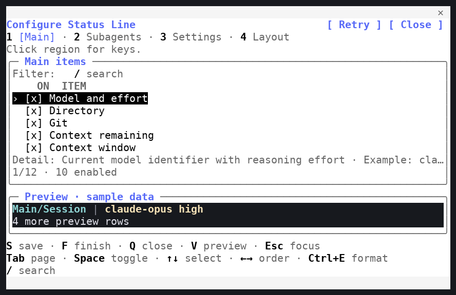
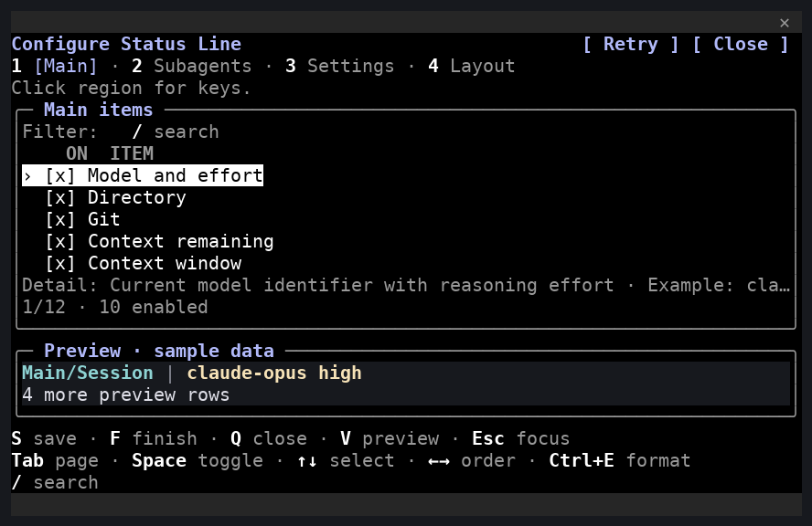

# In-session Client configuration editor

**English** | [简体中文](native.zh-CN.md)

For everyday operations, see [configuration editors](../EDITORS.md). This page maintains implementation and acceptance details.

Current native capacity and recovery use bounded visible frames and add three-platform Claude 2.1.310 gates; see [implementation and acceptance](native-capacity.md).

Since v1.3.0, the project provides Client TUI inside the current Claude Code terminal session. `/statusline-configure-native` opens this Mod pane; `/statusline-configure` opens the external TypeScript TUI through its platform launcher. Stable defaults both on, with independent preferences and version suspension.

## Source layout and checks

`mods/statusline-native` is the only native-editor Mod source; the installed plugin identity remains `statusline-native@claude-statusline-local`. `hooks/register.ts` owns host API calls, commands, backend requests, save lifetimes and serialized input batches. `lib/editor/` owns draft/order/numeric rules; `lib/client/` owns validated batches, keys and settings; `lib/session.ts` serializes independent snapshots. `ui/client/` owns surface input and drawing, `ui/components/` reusable sections, and `ui/layout.ts` the cell budget. Tests mirror backend, client, editor, integration and UI responsibilities. The external TypeScript UI lives in `packages/tui`; platform launchers remain separate and both editors use the shared CLI configuration services.

`ui/client/help.ts` selects state-dependent footer controls and computes their wrapped row budget. Drawing and keyboard pagination both use `editorLayout`; complete hint wrapping lives in `ui/components/shortcuts.ts`. The heading uses the host theme accent for **Configure Status Line**. All idle page controls begin with Tab; Main/Subagents order is Tab, A/D/X (add/copy/remove), Space, selection arrows, ordering arrows, Ctrl+E and search. Settings offers H to show/hide preferences and A only when expanded; item forms offer Ctrl+G back. Filter retains its search entry. Editing offers accept/cancel/clear/delete, while ordinary letter shortcuts accept either ASCII case only outside editing and Ctrl/Meta combinations. Esc remains host-owned.

At 32×12, shorten hints and omit secondary V/R/Esc help before sacrificing current controls. Auxiliary detail/count rows yield space to the footer; the selected row and one actual sample row remain visible. Resizing retains state and recomputes both rendering and navigation from the same budget. These presentation changes do not modify protocol or configuration schemas.

Use Node.js 24.21.0/npm 11.19.0, the matching development backend, and the fixed host builds in CI. Regenerate official declarations for each actual host; never reuse declarations from another build. The fixed host inventory and applicable capacity checks are defined in [CI maintenance](ci-maintenance.md) and [capacity/recovery](native-capacity.md), including the separately reported 2.1.296 declaration gap.

```bash
npm ci --prefix mods/statusline-native --ignore-scripts --no-audit --no-fund
npm run mods:prepare -- --plugin mods/statusline-native
claude plugin validate --strict mods/statusline-native
claude plugin test mods/statusline-native
npm run --prefix mods/statusline-native typecheck
```

The native Mod registers `/statusline-configure-native` and `/statusline-task`; the external editor launcher remains a separate integration. Dependencies, generated host declarations and raw validation reports are excluded from runtime packages. No model call is required by ordinary checks.

For a source backend, first run `npm run build`. Set plugin `backendExecutable` to the absolute Node path and `backendArgs` to a JSON array containing the absolute compiled `packages/cli/dist/src/entry.js` path. Persistent `install` writes these bindings automatically.

## Theme rendering

`ui/theme.ts` centralizes host color roles. Normal text and bold keys use `text`; titles and active tabs use `suggestion`; regular descriptions and borders use `inactive`; errors use `error`. The main surface pairs `text` with `inverseText`, and selection reverses that pair explicitly. Avoid combining inactive colors with terminal dimming. The host resolves these tokens for its applied standard, daltonized, ANSI, auto and custom themes; editing a theme preference alone does not apply it. Recovery buttons use the supported primary variant and remain outside Client.

`ui/components/preview.ts` draws production foreground spans and cell-width padding on the UI-only `light` (`#ffffff`) or `dark` (`#17191e`) background, including loading/error, empty and overflow rows. RGB spans keep their values; ANSI spans use `ansi256(0..15)` so named-color remapping cannot change terminal slots. Plain spans use terminal foreground. Chrome backgrounds are scoped to header, content, footer and frame edges. The host paints a docked Pane’s default Client cells with its own sidebar background, so transparent/default props do not reproduce the terminal background there. The supported solution keeps the preview in the pane and offers **Preview background (UI only)** separately from Palette. Host hooks read/write the plugin-scoped `preview-background` store key; changes remember immediately, failed writes restore the previous choice, and invalid/missing values default to dark. This setting is outside display drafts, portable files and backend protocols. Titles show both choices, shortened below 64 columns. The editor does not query the terminal's exact RGB background; compare `default` and `ansi` when needed.

[Linux light/dark capture provenance](../images/README.md#theme-terminal-captures). These are cropped reconstructions of real terminal cells, not OS screenshots or new human acceptance.





## Editor behavior

Opening, key controls, draft operations and window adaptation are documented in [configuration editors](../EDITORS.md). In the existing Linux 2.1.288 observation, `focus: true` did not establish Client keyboard focus. Esc is not delivered to Client; the host manages focus and closure.

The pane requests a 72×24 body; actual placement and space belong to the host. The minimum usable body is 32×12. Drawing and navigation share the layout budget, retaining the draft and selected field after resize. Enabled and disabled instances retain placement, only enabled instances render, and exclusions come from the shared catalog.

Sample preview uses fixed data and production formatting, with at most three rows plus an overflow count. Draft or width changes request a new sample; height changes and navigation reuse it. Client input is sent as cumulative ordered batches, acknowledged and deduplicated. Port snapshots contain only detached visible presentation nodes because the host freezes them; complete drafts stay in the host. Stale props, old epochs and late preview replies cannot replace current state.

Reexecuting the native command focuses the existing pane and keeps its draft. External TUI and Client may be open concurrently. Both save through the same short-lived file lock and opening revision: the first commit wins; a stale draft gets a conflict instead of overwriting. Client retains its draft on conflict; r explicitly discards/reloads. Unknown results require k, which reads without resubmitting or automatically closing.

Claude appearance, time/title and model/effort/thinking/fast behavior use actual `$.config.list()` rows. Apply rechecks locks/current values per row, reports partial results, and is separate from tool configuration. Finish does not silently discard pending preferences. On Client failure, received host-side drafts remain available. Retry/Close buttons remain outside Client so load failures can be recovered. Builds 2.1.287/2.1.288 retain preflight, caught drawing errors and native recovery buttons. On newer hosts the compatible observer also handles `ui.fault` and renders a host-only recovery view.

<a id="client-page-hierarchy-footer-and-pagination"></a>

## Client page hierarchy, footer and pagination

User operations moved to [configuration editors: Client pagination and footer](../EDITORS.md#client-pagination-and-footer). Layout budgets, host color roles and visible-frame implementation remain in [source layout and checks](#source-layout-and-checks), [theme rendering](#theme-rendering) and [editor behavior](#editor-behavior) above.

<a id="external-terminal-editor-page-regions-and-footer"></a>

## External terminal editor page regions and footer

User operations moved to [configuration editors: terminal page regions and footer](../EDITORS.md#terminal-page-regions-and-footer). The external implementation remains in `packages/tui`; current test entry points are in [testing and acceptance](testing.md). [v3.16.0 captures](../images/typescript/v3.16.0/README.md) retain their original version identity.

## External TUI

`packages/tui` owns the external terminal editor over shared pure editor rules and an injected backend. `session.ts` opens the session, reads the description, configuration and UI preference, and runs the event loop; `state.ts` holds editor state and delegates document operations to the shared core managers; `drawing.ts` and `drawing/` render colored cell frames; `layout.ts` computes size and paging budgets; `navigation.ts` pages long forms; `setup.ts` runs the persistent-install setup flow; `task-viewer.ts` provides read-only task pages; and `theme.ts` maps the editor palette. The package depends on `@fbincon/statusline-core` and `@fbincon/statusline-platform` only and does not import CLI services.

`claude-statusline configure [--config-dir PATH] [--user|--profile NAME_OR_ID|--project PATH]` is the direct launcher. The `/statusline-configure` slash entry requires the schema-v1 `experimental_slash_tui` preference and a verified Claude Code 2.1.258+ host, then uses the platform launcher; `install --experimental-slash-tui` / `--no-experimental-slash-tui` persists that entry. The launcher selects a terminal adapter and passes a private request/result directory, nonce, deadline and backend `LaunchSpec`; revocation is rechecked under the configuration lock.

The editor exchanges current UI protocol operations through its injected `Backend.request` boundary and uses `Backend.control` only for package-manager process operations. It opens with the `read` revision and submits `apply` with that revision; conflicts retain the draft. Installed frontend and backend resources must match. Current versions are in the [CLI reference](../reference/cli.md#protocol-and-schema-versions); envelope and save rules are in [shared contracts](contracts.md#transport-and-response-envelopes) and [revision and transactions](contracts.md#revision-and-transactions).

User operations are documented in [configuration editors: terminal page regions and footer](../EDITORS.md#terminal-page-regions-and-footer). Historical parity and regression evidence remains in the [external TUI parity](history/migration/external-tui-parity.md) and [external TUI regressions](history/migration/external-tui-regressions.md) records; reconstructed terminal cells do not establish human desktop acceptance.

## Persistent installation and recovery

```bash
claude-statusline install --experimental-slash-tui --native-editor
claude-statusline doctor
```

Restart Claude Code in a trusted terminal, then use either command. `--experimental-slash-tui` and `--no-experimental-slash-tui` control only the external entry. `--native-editor` and `--no-native-editor` control only Client integration. Stable defaults both on, preserving recorded disablement; historical Python prereleases default both off. TS previews retain the stable defaults under the [TS-06 amendment](typescript-migration/ts-06/README.md). External needs 2.1.258+ and Client 2.1.287+. Older/unknown hosts suspend each independently; explicit enabling also does not fail basic installation for unsupported versions. Reinstall after upgrading restores support. External disablement saves schema-v1 false rather than deleting its file; historical absence follows the new stable default. Reinstall restores an enabled owned external skill/hook removed by older native migration. Mod no longer registers the external name or declares `primaryCommand`.

Native resources are staged under `CLAUDE_CONFIG_DIR/statusline-native`, verified by hash/version/protocol inventory, and installed through official local marketplace commands. The installer binds absolute backend/config paths and backend version. Backend and Mod must come from the same package version and protocol. Foreign native commands/resources block that integration; external collisions are checked when enabling the external entry. An unrelated external command does not block native-only installation. Altered owned caches are not adopted.

Native disablement removes only confirmed owned native plugin/marketplace resources. The external entry keeps its own preference and artifacts. Uninstall retains display configuration, preferences, backups and runtime data. Failed operations report actual disk state; doctor checks resources, binding and enablement separately from session loading. Externally disabled plugins stay disabled; only tool-recorded suspension is automatically restored. Safe/bare mode, managed policy and disableAllHooks can prevent Mod loading. Before package downgrade, disable native using the newer package, then install the older package.

On older/unrecognized hosts, a verified owned native plugin is suspended under the installation lock by changing only its enabledPlugins entry and tool suspension marker, with backups and rollback. This path does not call newer Mod APIs and does not turn user disablement into tool suspension. See [user installation combinations](../USER_GUIDE.md#editor-installation-combinations-and-compatibility).

## Linux acceptance

Set `ARTIFACT` and `SOURCE_COMMIT` to the built package and its immutable commit. The current automated Linux runner uses isolated configuration and sends only local slash commands. It records terminal cells, versions and source state; captures are reconstructions of actual terminal output, not OS screenshots or human acceptance. Installed acceptance checks terminal save/cancel and shared protocol persistence; Mod acceptance validates the actual supported host and binding. These commands do not establish human focus or same-conversation desktop behavior.

```bash
npm run test:installed -- --artifact "$ARTIFACT" --commit "$SOURCE_COMMIT" --report dist/validation/native/installed.json
npm run test:mods -- --artifact "$ARTIFACT" --commit "$SOURCE_COMMIT" --report dist/validation/native/mods.json
```

Record each fixed candidate's real loading, initial click, Space/Enter, page/order/search, numeric Ctrl+G, save/finish/cancel, Esc focus/close, narrow/CJK layout, preferences, conflicts and return to the same session. Windows/macOS human checks remain separate from CI.

## Stable acceptance record

The v1.2.0 UI passed the maintainer's Linux, Windows 11 and macOS 14.5 checklists before stable promotion. The original records remain in the v1.2.0 release documentation; unprovided architecture/terminal details remain unknown.

## v1.3.0 acceptance status

On 2026-10-04 the maintainer explicitly confirmed v1.3.0a1's redesigned native-control UI passed human acceptance on Linux, Windows and macOS. Additional architecture, terminal and host outputs were not supplied with this confirmation. The a1 and a2 human results are recorded separately.

On the same date the maintainer separately confirmed **v1.3.0a2 human acceptance passed on Linux, Windows and macOS**. No terminal, architecture, exact host versions or independent report accompanied this confirmation; those metadata remain unknown. Stable v1.3.0 retains a2 Client interaction, changing version/description and installation defaults/suspension policy. Regression, real Linux PTY, packaging and installation validate those changes separately. Automated checks are not human acceptance; no paid timer suite is run for this promotion.

## Claude Code 2.1.289 interaction report

Later on 2026-10-04 the maintainer supplied [three actual terminal screenshots](../images/archive/README.md#in-session-client-screenshots), each visibly showing Claude Code 2.1.289, and reported normal in-session Client use on Linux and Windows. On macOS the Client pane opens but interaction is not working correctly. The maintainer has not found or verified a working mouse configuration. Backend/source versions and exact OS, architecture and terminal-version metadata were not supplied for this report.

The earlier release acceptance records above retain their original scope. This later macOS result remains unresolved; an open pane or passing automated CI does not establish mouse delivery, keyboard focus or successful editing. [Official mouse reporting checks](../USER_GUIDE.md#macos-mouse-reporting-and-client-focus) are documented as suggestions, not a verified fix.

A follow-up macOS acceptance record should identify the host, backend and terminal versions, terminal mouse-reporting settings, and whether tmux/SSH is involved. Verify initial click, Tab/arrows/Space, save/reopen, discard and return to the same session before recording success. This documentation update does not supply a new macOS acceptance run.

References: [actual-build Mod types](https://code.claude.com/docs/en/plugins/mods/create), [official tests](https://code.claude.com/docs/en/plugins/mods/test), [local marketplaces](https://code.claude.com/docs/en/plugin-marketplaces).

## Phase 4 editor acceptance

> **Historical Python/Curses-era record.** This section preserves the Phase 4 editor acceptance of the pre-TypeScript implementation. The current TypeScript editor and its checks are documented above.

Main/Subagents opened scoped formats with Ctrl+E. Layout managed explicit boundaries, priorities and terminal-column widths. Settings expanded presets and imported into an unsaved draft, exported that draft separately, and unfolded actual host appearance/time/title/behavior rows. Ctrl+G restored an input or returned from a scoped form; Enter accepted fields. Curses kept legacy Enter saves and added Ctrl+S for every page, using raw input to avoid XON/XOFF swallowing the chord.

The historical check ran [`archive/python/tools/native_mod_acceptance.py`](../../archive/python/tools/native_mod_acceptance.py) `--persistent --advanced --report-dir dist/validation/<new-directory>` from an installed candidate wheel. It checked both persistent entries at 120×30 and 80×48, CJK label/path input, ANSI palette, explicit boundaries/priority/width saves, preset/export/import validation, cancellation without writes and cross-editor readback. Raw logs remained private. Human Linux/Windows and macOS available-entry acceptance was confirmed on 2026-10-05; the previously reported macOS Client input limitation remains open.

## v1.5.0 stable acceptance

On 2026-10-05 the maintainer confirmed Phase 4 human acceptance on Linux and Windows and on macOS through the standalone TUI/CLI. Exact OS, architecture, terminal and host versions were not supplied. This confirmation does not declare the earlier macOS in-session Client input problem fixed.

Stable changes package/Mod versions and release defaults; formatting, layout, portable files, host application and accepted input behavior remain those of the verified preview. Automated CI/PTYs and agent capture inspection remain independent evidence. Historical preview images keep their a1 filenames, capture hashes and original source commits.

## v1.6.0 stable acceptance

See the [historical acceptance record](history/acceptance-records.md#v160-stable-acceptance) for the maintainer's confirmation, editor defaults and macOS Client input limitation.

## Terminal background previews

Choose **Preview background (UI only)** to match the terminal’s light/dark appearance, independently of the applied Claude theme. The following reconstructed captures use explicit terminal-default and xterm-palette analysis fixtures, not newly configured physical terminals or human acceptance.

| Terminal / Claude theme | default | ANSI |
| --- | --- | --- |
| light / light | [Preview](../images/archive/python-era/tui/native/linux/preview-backgrounds/light-terminal-light-theme-default.png) | [Preview](../images/archive/python-era/tui/native/linux/preview-backgrounds/light-terminal-light-theme-ansi.png) |
| light / dark | [Preview](../images/archive/python-era/tui/native/linux/preview-backgrounds/light-terminal-dark-theme-default.png) | [Preview](../images/archive/python-era/tui/native/linux/preview-backgrounds/light-terminal-dark-theme-ansi.png) |
| dark / light | [Preview](../images/archive/python-era/tui/native/linux/preview-backgrounds/dark-terminal-light-theme-default.png) | [Preview](../images/archive/python-era/tui/native/linux/preview-backgrounds/dark-terminal-light-theme-ansi.png) |
| dark / dark | [Preview](../images/archive/python-era/tui/native/linux/preview-backgrounds/dark-terminal-dark-theme-default.png) | [Preview](../images/archive/python-era/tui/native/linux/preview-backgrounds/dark-terminal-dark-theme-ansi.png) |

[Capture provenance](../images/README.md#native-preview-background-captures).

## Interface language

Settings includes the independent **Interface language (saved immediately)** row. The host reads `read_ui_preferences` on opening/reload and executes `set_ui_language` as a separate effect. The Client retains current page/selection/search/input, and semantic messages remain renderable after a switch or frozen-port copy. Failed writes restore the prior view language; closed/old epochs cannot replace newer state. Host preference Apply and display Save remain separate. Search includes all registered languages, IDs and custom labels through a prepared local index.

The [Linux bilingual captures](../images/README.md#bilingual-terminal-captures) show all four pages and English/Chinese selectors. Persistent PTYs use an explicit light preview surface; the real host quantizes RGB to 256 colors in this multiplexer path. Direct theme PTYs separately preserve RGB. These observations do not establish new human or other-platform focus acceptance. See [language implementation](i18n.md).
