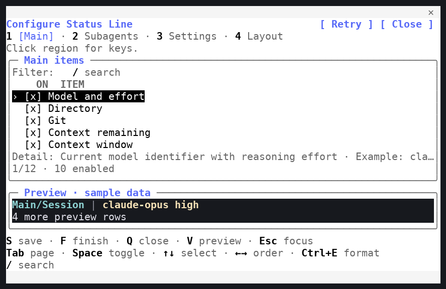
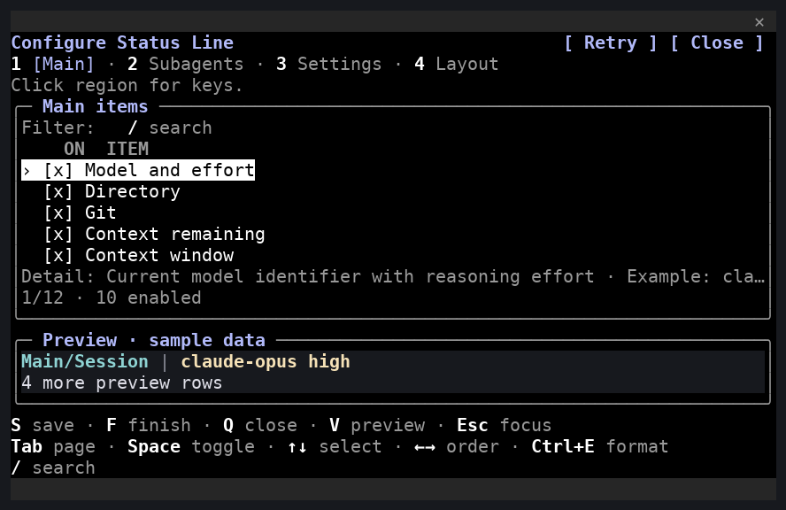

# 会话内 Client 配置编辑器

**简体中文** | [English](native.md)

日常操作见[配置编辑器](../EDITORS.zh-CN.md)，本页维护实现与验收说明。

当前 Native 容量与恢复采用有界可见帧，并新增三平台 Claude 2.1.310 门禁；详见[实现与验收](native-capacity.zh-CN.md)。

从 v1.3.0 起提供当前 Claude Code 终端 session 内的 Client TUI。`/statusline-configure-native` 打开 Mod 面板；`/statusline-configure` 通过平台启动器打开外部 TypeScript TUI。正式版默认启用两者，按偏好及宿主版本分别降级。

## 源码结构与检查

`mods/statusline-native` 是唯一 Mod 源码，安装身份仍为 `statusline-native@claude-statusline-local`。`hooks/register.ts` 负责宿主 API、命令、后端请求、保存生命周期与输入批次串行处理；`lib/editor/` 负责草稿、排序及数值规则；`lib/client/` 负责消息校验、按键和设置；`lib/session.ts` 生成独立的有界可见帧。`ui/client/` 负责 Client 输入和绘制，`ui/components/` 提供共享板块，`ui/layout.ts` 计算单元格预算。测试对应 backend、client、editor、integration、UI。外部 TypeScript 界面位于 `packages/tui`，平台启动器独立维护，双编辑器共用 CLI 配置服务。

`ui/client/help.ts` 根据状态选择底部快捷键并计算换行预算，绘制与键盘分页共同使用 `editorLayout`；完整提示组换行放在 `ui/components/shortcuts.ts`。大标题 **Configure Status Line** 使用宿主主题强调色。所有非编辑页面提示以 Tab 开头；Main/Subagents 顺序为 Tab、A/D/X（添加／复制／删除）、Space、选择方向键、排序方向键、Ctrl+E、搜索。Settings 用 H 展开／收起偏好，展开后才显示 A；逐项格式显示 Ctrl+G 返回。Filter 保留搜索入口。编辑时显示接受／取消／清空／删除；普通字母快捷键仅在非编辑且无 Ctrl/Meta 时兼容 ASCII 大小写。Esc 仍由宿主管理。

32×12 下先缩短说明，再省略 V/R/Esc 等次要提示；详情／计数行让出空间，保留当前操作、选中项及一行实际样例预览。缩放保留状态，绘制与导航使用同一预算重新计算。本次展示改动不改变协议或配置 schema。

开发使用 Node.js 24.21.0／npm 11.19.0、匹配的后端和固定宿主。每个宿主重新生成官方声明，不能复用其他版本类型。固定宿主清单和适用容量检查由 [CI 维护](ci-maintenance.zh-CN.md)及[容量／恢复](native-capacity.zh-CN.md)定义，2.1.296 类型声明缺口单独报告。

```bash
npm ci --prefix mods/statusline-native --ignore-scripts --no-audit --no-fund
npm run mods:prepare -- --plugin mods/statusline-native
claude plugin validate --strict mods/statusline-native
claude plugin test mods/statusline-native
npm run --prefix mods/statusline-native typecheck
```

源码后端先运行 `npm run build`，将插件的 `backendExecutable` 设为 Node 绝对路径，`backendArgs` 设为包含已编译 `packages/cli/dist/src/entry.js` 绝对路径的 JSON 数组；持久安装的 `install` 自动写入绑定。

Native Mod 注册 `/statusline-configure-native` 和 `/statusline-task`；外部编辑器启动器属于独立接入。依赖、宿主生成声明和原始验证记录不进入运行资源；普通检查不调用模型。

<a id="theme-rendering"></a>

## 主题绘制

`ui/theme.ts` 集中维护宿主颜色职责：正文及粗体快捷键使用 `text`，标题和活动页签使用 `suggestion`，普通说明和边框使用 `inactive`，错误使用 `error`。主界面使用 `text`／`inverseText` 明确配对，选中行交换这组前景和背景。辅助色避免再叠加终端淡化。宿主按实际应用的普通、色弱、ANSI、auto 或自定义主题解析这些颜色；仅编辑主题偏好不会应用。恢复按钮使用受支持的 primary 样式，并保留在 Client 外部。

`ui/components/preview.ts` 在仅用于界面的 `light`（`#ffffff`）或 `dark`（`#17191e`）底色上绘制生产前景 span 及按单元格宽度填充的空格，包括加载／错误、空白和溢出行。RGB 保留原值；ANSI 使用 `ansi256(0..15)`，避免命名颜色映射改变终端色槽。无色 span 使用终端默认前景。主界面背景限定在标题、正文、页脚和框线。宿主会把停靠 Pane 中 Client 的默认背景单元格重绘为侧边栏底色，因此透明／default 属性无法在该位置还原终端背景。实现保留框内预览，并提供独立于 Palette 的 **Preview background (UI only)**。宿主 hooks 读写插件范围内的 `preview-background` 存储键；选择立即记住，写入失败恢复原选择，缺失／无效值默认深色。该偏好不进入显示草稿、可移植文件或后端协议。标题显示两项选择，64 列以下使用短标题。编辑器不查询终端背景的精确 RGB；需要时比较 `default` 与 `ansi`。

[Linux 浅色／深色捕获来源](../images/README.zh-CN.md#主题终端捕获)。图片是实际终端单元格的裁剪重建，与系统截图及真人验收分别记录。





## 编辑器行为

打开、键位、草稿操作及窗口适配见[配置编辑器](../EDITORS.zh-CN.md)。Linux 2.1.288 的既有观察中，`focus: true` 未让 Client 自动收键；Esc 不传给 Client，仍由宿主管理焦点与关闭。

面板请求正文 72×24，实际空间与位置由宿主决定；最小可用正文为 32×12。绘制与导航共用布局预算，缩放后保留草稿及选中字段。启用与禁用实例均保留位置，仅启用项渲染；互斥规则来自共享 catalog。

预览使用固定样例及生产格式，最多显示三行并报告溢出行数。草稿或宽度变化重新请求，导航及高度变化复用缓存。Client 输入采用累积有序批次、确认及去重；宿主会冻结端口对象，所以只传递独立可见帧，完整草稿保留在宿主。旧 props、旧 epoch 和迟到预览不能替换当前状态。

重复执行原生命令会聚焦现有面板并保留草稿。外部 TUI 和 Client 可同时打开；保存共用短期文件锁和打开时版本，先保存者生效，旧草稿提示冲突且不覆盖新配置。Client 冲突时保留草稿，r 明确丢弃重载。结果不明须先 k 只读核对，不重新提交或自动退出。

Claude 外观／时间／标题及模型／effort／thinking／fast 行为只使用 `$.config.list()` 的真实行。Apply 逐项重查锁定及当前值，报告部分成功，与工具配置保存分开。Finish 不默默丢弃待应用偏好。Client 故障保留宿主已接收草稿；Client 外始终保留 Retry/Close 按钮供加载失败时恢复。2.1.287/2.1.288 保留预检查、内部绘制异常处理和原生恢复按钮；较新宿主还通过兼容观察器处理 `ui.fault`，显示独立宿主恢复页。

<a id="client-page-hierarchy-footer-and-pagination"></a>

## Client 页面层级、底部提示与分页

用户操作说明迁至[配置编辑器：Client 分页与底部提示](../EDITORS.zh-CN.md#client-pagination-and-footer)。布局预算、宿主颜色角色及可见帧实现见上方[源码结构与检查](#源码结构与检查)、[主题绘制](#theme-rendering)及[编辑器行为](#编辑器行为)。

<a id="external-terminal-editor-page-regions-and-footer"></a>

## 终端编辑器的区域与底部提示

用户操作说明迁至[配置编辑器：终端页面区域与底部提示](../EDITORS.zh-CN.md#terminal-page-regions-and-footer)。外部实现仍位于 `packages/tui`，现行测试入口见[测试与验收](testing.zh-CN.md)；[v3.16.0 采集](../images/typescript/v3.16.0/README.zh-CN.md)保留原始版本身份。

## 外部 TUI

`packages/tui` 在共享纯编辑规则及注入后端之上实现外部终端编辑器。`session.ts` 打开会话、读取描述／配置／界面偏好并运行事件循环；`state.ts` 保存编辑器状态，并把文档操作交给共享 core 管理器；`drawing.ts` 与 `drawing/` 绘制带颜色的单元格帧；`layout.ts` 计算尺寸与分页预算；`navigation.ts` 为长表单分页；`setup.ts` 运行持久安装设置流程；`task-viewer.ts` 提供只读任务页面；`theme.ts` 映射编辑器调色板。该包只依赖 `@fbincon/statusline-core` 与 `@fbincon/statusline-platform`，不导入 CLI 服务。

`claude-statusline configure [--config-dir PATH] [--user|--profile NAME_OR_ID|--project PATH]` 是直接启动入口。`/statusline-configure` 斜杠入口要求 schema v1 的 `experimental_slash_tui` 偏好及已核验的 Claude Code 2.1.258+ 宿主，随后使用平台启动器；`install --experimental-slash-tui` / `--no-experimental-slash-tui` 持久化该入口。启动器选择终端适配器，并传递私有请求／结果目录、nonce、截止时间及后端 `LaunchSpec`；配置锁内会再次复核撤销。

编辑器通过注入的 `Backend.request` 边界调用当前 UI 协议操作，仅通过 `Backend.control` 执行包管理进程操作。它以 `read` 的 revision 打开，并使用该 revision 提交 `apply`；冲突保留草稿。已安装前端与后端资源必须匹配。当前版本见 [CLI 参考](../reference/cli.zh-CN.md#协议与-schema-版本)，封装与保存规则见[共享契约](contracts.zh-CN.md#传输与操作)及[修订与事务](contracts.zh-CN.md#revision-与事务)。

用户操作见[配置编辑器：终端页面区域与底部提示](../EDITORS.zh-CN.md#terminal-page-regions-and-footer)。历史对等与回归证据保留在[外部 TUI 对等记录](history/migration/external-tui-parity.zh-CN.md)和[外部 TUI 回归记录](history/migration/external-tui-regressions.zh-CN.md)；终端单元格重建不代表人工桌面验收。

## 持久安装与恢复

```bash
claude-statusline install --experimental-slash-tui --native-editor
claude-statusline doctor
```

在受信任终端中重启 Claude Code，再选择任一命令。`--experimental-slash-tui` / `--no-experimental-slash-tui` 只控制外部入口；`--native-editor` / `--no-native-editor` 只控制 Client。正式版新安装默认都启用；明确关闭优先，历史 Python 预览版默认都关闭，TS 预览依据 [TS-06 修订](typescript-migration/ts-06/README.zh-CN.md)保留稳定默认值。外部需 2.1.258+，Client 需 2.1.287+，低版本或未知版本分别暂挂，显式启用也不因版本不兼容使基础安装失败。升级后重装恢复。外部关闭保存 schema v1 的 false，不再删除文件；旧版无记录按正式默认处理。若旧原生迁移曾移除已启用的外部 skill/hook，重装会恢复本工具所属资源。Mod 不再注册外部命令名，也不再声明 `primaryCommand`。

原生资源暂存于 `CLAUDE_CONFIG_DIR/statusline-native`，核验哈希、版本及协议清单后，经官方本地 marketplace 命令安装。绑定绝对后端路径、配置目录和版本；后端与 Mod 应来自同一版本和协议的安装包。外来原生命令或资源阻止该入口安装，外部冲突在启用外部入口时检查；外来外部命令不会阻止仅安装 Client。被修改的 owned 缓存不被接管。

禁用原生只移除核实所属的原生插件、marketplace 和资源，外部入口保留自身偏好及资源。卸载保留显示配置、偏好、备份和运行数据。失败报告实际状态；doctor 分别检查资源、绑定及启用情况，当前 session 加载仍须核实。外部禁用的插件保持禁用，仅自动恢复工具记录的暂挂。safe/bare、管理策略及 disableAllHooks 可阻止加载。降级 Python 包前先用新版禁用原生，再安装旧包。

低版本或无法识别的宿主对已核验所属的原生插件，在安装锁内仅关闭其 enabledPlugins 项并记录工具暂挂，备份设置及 owner 后原子写入，失败回滚。该路径不调用较新 Mod API；主动禁用不转成工具暂挂。参见[用户安装组合](../USER_GUIDE.zh-CN.md#编辑器安装组合与兼容性)。

## Linux 验收

自动 Linux 运行器使用隔离配置，仅发送本地斜杠命令，记录终端单元格、版本及源码状态；图像是实际终端输出重建，不是系统像素截图或真人验收。安装验收覆盖终端保存／取消和共享协议持久化；Mod 验收验证实际支持宿主和绑定，不代表人工焦点或同一对话中的桌面行为。

先将 `ARTIFACT` 和 `SOURCE_COMMIT` 设为构建包及其不可变提交。

```bash
npm run test:installed -- --artifact "$ARTIFACT" --commit "$SOURCE_COMMIT" --report dist/validation/native/installed.json
npm run test:mods -- --artifact "$ARTIFACT" --commit "$SOURCE_COMMIT" --report dist/validation/native/mods.json
```

固定候选需核实实际加载、首次点击、Space/Enter、切页/排序/搜索、数值 Ctrl+G、保存/完成/取消、Esc 焦点及关闭、窄窗/CJK、偏好、冲突和继续同一 session。Windows/macOS 真人检查与 CI 分开记录。

## 稳定版验收记录

v1.2.0 在晋升稳定版前，已获维护者确认 Linux、Windows 11、macOS 14.5 的完整真人清单通过。原始结论保留在 v1.2.0 发布文档；未提供的架构与终端信息保持未知。

## v1.3.0 验收状态

2026-10-04 维护者明确确认 v1.3.0a1 的新原生控件界面在 Linux、Windows、macOS 真人验收通过。本次确认未补充架构、终端和宿主输出。a1 与 a2 的真人验收分别记录。

同日维护者另行明确确认 **v1.3.0a2 的 Linux、Windows、macOS 真人验收通过**。此次确认未附终端、架构、宿主版本或独立报告，相关元数据保持未知。正式 v1.3.0 沿用 a2 的 Client 交互，仅调整版本/描述及安装默认与降级策略；这些变更另经回归、真实 Linux PTY、打包和安装验证。自动检查不计作真人验收；本轮不运行付费计时套件。

## Claude Code 2.1.289 交互反馈

2026-10-04 稍后，维护者提供了[三张实际终端截图](../images/archive/README.zh-CN.md#会话内-client-截图)，均可见 Claude Code 2.1.289，并反馈 Linux、Windows 会话内 Client 可以正常使用；macOS Client 面板可以打开，但交互不正常，尚未找到并验证有效的鼠标配置。本次反馈未提供后端或源码版本、准确系统版本、架构与终端版本。

上面的历史发布验收记录保留原有范围。本次 macOS 问题仍未解决，面板打开或自动 CI 通过均不代表鼠标传递、键盘焦点及编辑操作已验证。[官方鼠标报告检查步骤](../USER_GUIDE.zh-CN.md#macos-鼠标报告与-client-焦点)作为建议记录，不宣称已验证修复。

后续 macOS 验收应记录宿主、后端、终端版本、终端鼠标报告设置，以及是否经过 tmux 或 SSH；核实首次点击、Tab／方向键／Space、保存重开、丢弃及返回同一会话后，才记录通过。本次文档更新不提供新的 macOS 验收运行结果。

参考：[实际版本 Mod 类型](https://code.claude.com/docs/en/plugins/mods/create)、[官方测试](https://code.claude.com/docs/en/plugins/mods/test)、[本地 marketplace](https://code.claude.com/docs/en/plugin-marketplaces)。

## Phase 4 编辑器验收

> **Python／Curses 时期历史记录。** 本节保留 TypeScript 之前实现的 Phase 4 编辑器验收。当前 TypeScript 编辑器及其检查见上方章节。

当时，Main/Subagents 用 Ctrl+E 打开逐项格式；Layout 管理显式行边界、优先级与终端列宽；Settings 将预设／导入展开为未保存草稿，另行导出，并展开宿主实际外观／时间／标题／行为行。Ctrl+G 恢复输入或返回列表，Enter 接受字段。curses 保留旧 Enter 保存并增加任意页 Ctrl+S，使用 raw 模式避免 XON/XOFF 吞键。

当时从安装的候选 wheel 运行 [`archive/python/tools/native_mod_acceptance.py`](../../archive/python/tools/native_mod_acceptance.py) `--persistent --advanced --report-dir dist/validation/<new-directory>`，检查 120×30／80×48 两种尺寸、两种持久入口、中文标签／路径、ANSI 调色板、显式分行／优先级／宽度保存、预设／导出／导入验证、取消不写入及跨编辑器回读。原始日志保持私有。Linux／Windows 及 macOS 可用入口人工验收已于 2026-10-05 确认，之前报告的 macOS Client 输入问题仍未解决。

## v1.5.0 正式验收

2026-10-05，维护者确认 Phase 4 在 Linux、Windows，以及 macOS 的独立 TUI／CLI 入口人工验收通过；未提供具体 OS、架构、终端和宿主版本。本次确认不表示此前 macOS 会话内 Client 输入问题已修复。

正式版调整包／Mod 版本及发布默认值，格式、布局、可移植文件、宿主应用与已验收输入行为沿用已验证预览。自动 CI／PTY 与代理视觉检查分别记录；历史图片保留 a1 文件名、捕获哈希及原始源码提交。

## v1.6.0 正式版验收

维护者确认、编辑器默认设置及 macOS Client 输入限制见[历史验收记录](history/acceptance-records.zh-CN.md#v160-正式版验收)。

## 终端背景预览

按终端深浅选择 **Preview background (UI only)**，与 Claude 实际主题独立。下列重建捕获使用明确的终端默认色和 xterm 调色板分析夹具，不代表新配置的物理终端或真人验收。

| 终端／Claude 主题 | default | ANSI |
| --- | --- | --- |
| light / light | [Preview](../images/archive/python-era/tui/native/linux/preview-backgrounds/light-terminal-light-theme-default.png) | [Preview](../images/archive/python-era/tui/native/linux/preview-backgrounds/light-terminal-light-theme-ansi.png) |
| light / dark | [Preview](../images/archive/python-era/tui/native/linux/preview-backgrounds/light-terminal-dark-theme-default.png) | [Preview](../images/archive/python-era/tui/native/linux/preview-backgrounds/light-terminal-dark-theme-ansi.png) |
| dark / light | [Preview](../images/archive/python-era/tui/native/linux/preview-backgrounds/dark-terminal-light-theme-default.png) | [Preview](../images/archive/python-era/tui/native/linux/preview-backgrounds/dark-terminal-light-theme-ansi.png) |
| dark / dark | [Preview](../images/archive/python-era/tui/native/linux/preview-backgrounds/dark-terminal-dark-theme-default.png) | [Preview](../images/archive/python-era/tui/native/linux/preview-backgrounds/dark-terminal-dark-theme-ansi.png) |

[捕获来源](../images/README.zh-CN.md#原生预览背景捕获)。

## 界面语言

设置页增加独立的**界面语言（立即保存）**。宿主在打开／重新加载时读取 `read_ui_preferences`，通过独立效果执行 `set_ui_language`。Client 保留当前页面／选中项／搜索／输入，语义消息在切换或冻结端口复制后仍可翻译。写入失败恢复此前界面语言，关闭或旧 epoch 不覆盖新状态。Claude 偏好 Apply 与显示 Save 继续独立；搜索同时包含中英文名称／说明、ID 和自定义标签。

[Linux 双语采集](../images/README.zh-CN.md#双语终端采集)展示四页及中英文语言选项。持久化 PTY 使用明确浅色预览底色，真实宿主在该复用器路径将 RGB 量化为 256 色；直接主题 PTY 另行验证 RGB。此记录不代表新的人类或其他平台焦点验收。见[语言实现](i18n.zh-CN.md)。
