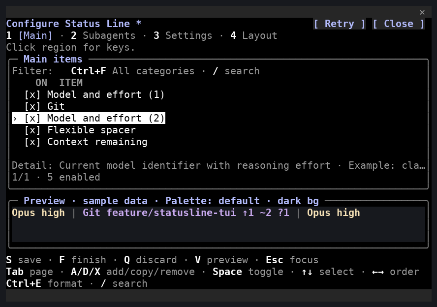
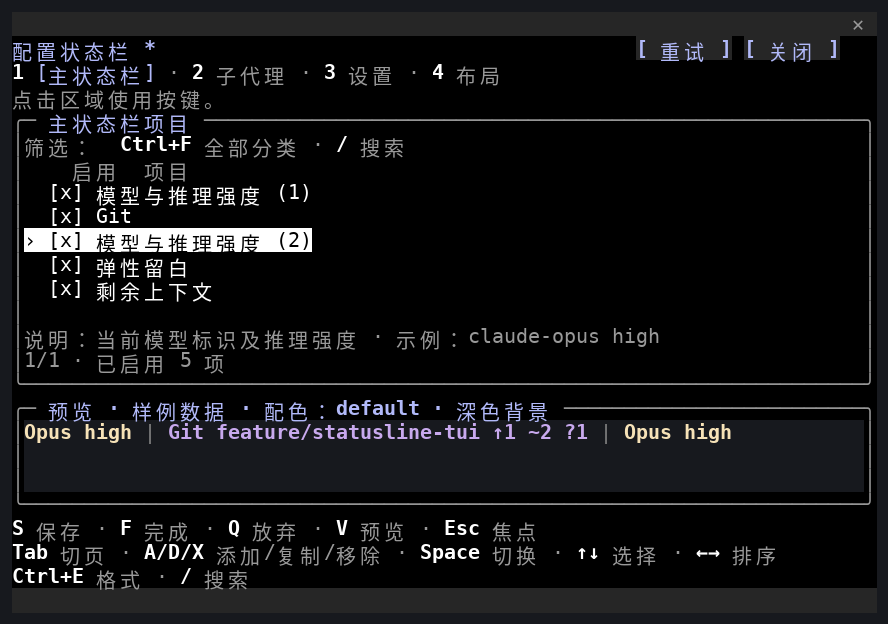
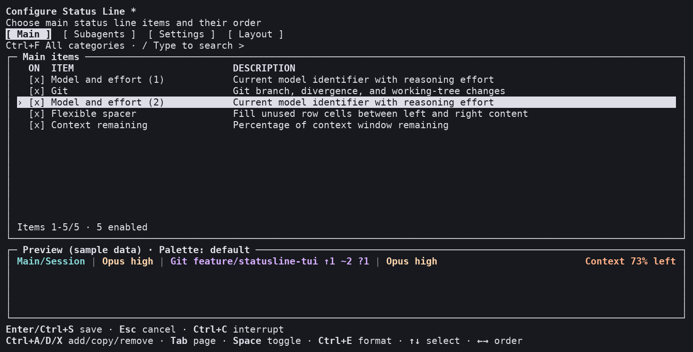
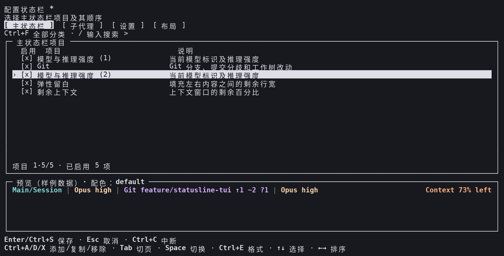

# 组件编辑器图像

[English](README.md) | **简体中文**

这些图像从真实安装包终端输出的字符单元格重建，预览采用固定样例；不属于操作系统截图或真人验收。实例编号区分同类型的副本。宽窗口可同时显示左侧组件与右侧上下文，窄窗口先压缩留白，再按优先级隐藏项目。

原生使用 A／D／X，外部使用 Ctrl+A／D／X。界面语言与输出语言独立，因此中文界面仍可预览英文输出。操作与迁移见[组件指南](../../COMPOSITION.zh-CN.md)。

| 入口 | English | 简体中文 |
| --- | --- | --- |
| 原生 Client |  |  |
| 外部 curses |  |  |

## 来源与边界

2026-10-11 在 Linux x86_64、Python 3.14.4、Claude Code 2.1.296 上采集，来自隔离安装的 2.0.0a1 wheel。原生源码为 `c5647ae`，外部源码为 `bb67f8f`；后续 UI 搜索及分类提示修正不改变这些画面。终端均为直接 PTY、120×30，原生图像只裁取 Client 面板；外部保留完整窗口。原始字节流与单元格 JSON 保留在忽略的 `dist/validation` 中，不随包发布。

字体使用 DejaVu Sans Mono、Noto Sans CJK 与 Noto Sans Symbols；固定的深色终端颜色仅用于重建。图像已由代理检查；真实字体表现以及 Windows／macOS 人工交互验收未由这些图像证明。

| 入口 / 语言 | Capture SHA256 | PNG SHA256 |
| --- | --- | --- |
| native / en | `68a5b50078f882ff846a22f80d968c52e8906fc198f6bb3dc424ca6fe8dfeef6` | `2427a9762727b56ff8932efbd364e7b23f589f6dee6988e8b2f6f260099b1d77` |
| native / zh-CN | `bbe991a4e41304b8266c86d10e1d0a29560eb5ef66823c78241761b4632d565d` | `6c4138e77a68877fb13323803477b872499de66523f0a4f4a6825ef9d3a37fe2` |
| external / en | `ba7bbec111c5dc4107a4b3a0842dc1eb2b5a3bf15b150691f04ca5a9c74a53ee` | `41ac7f57be29aa154bdc25e59dc6aa248c9c507420d8b9334390e97110562e2f` |
| external / zh-CN | `f065259aa9b3dde42c809ab1ad18a1a349dd682019a4e2a563cc17efdc3c6a44` | `cb703dcd57256e595e329e53986b1c88f7ca3dc3ca09f337cc62d92e8459dbc5` |
