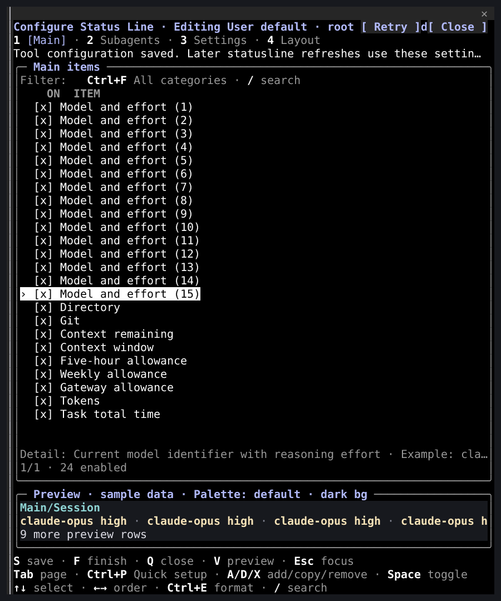
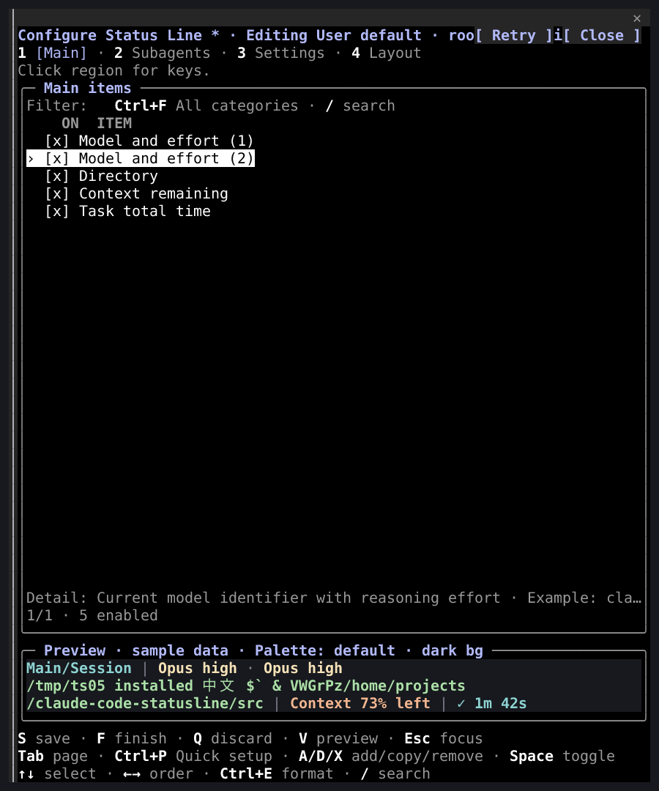

# Native 容量修复截图

[English](README.md) | **简体中文**

这五张图像重建自隔离 Linux x64 PTY 中已安装 v3.9.1 候选包的真实终端单元格，宿主为 Claude Code 2.1.310，Node 为 24.21.0。它们不是操作系统截图，也不是人工桌面验收。图中各流程均通过交互、保存／取消及宿主日志断言；最终发布门禁和包身份另见[交付记录](../../development/native-capacity.zh-CN.md)。

来源：[`d195f7a41d23d0b8d38c53addd7575e9a06e874a`](https://github.com/fbincon/claude-code-statusline/commit/d195f7a41d23d0b8d38c53addd7575e9a06e874a)。候选包 SHA-256：`34150c0bf8c0cbae0c4890c68e227cb2ca0cad55626c3b42279cc35ae2c31c9e`。裁剪保留原始文字和样式。[来源记录](provenance.json) 包含单元格、图像、渲染器、字体摘要和精确裁剪范围；原始 ANSI、单元格矩阵及宿主日志仅保留在本机验证目录。

| 场景 | 图像 | 已检查行为 |
| --- | --- | --- |
| 快速配置 | [外观选择](quick-setup.png) | 打开用途、选择候选、取消且不改变显示文件 |
| 四项前景渐变 | [预览](gradients.png) | 切换主／子代理页面并保留生产预览颜色 |
| 复制并保存 | [已保存的 24 个实例](saved-24.png) | 仅提交一次，回读 24 项，保存成功提示和操作控件可见 |
| 最小配置高面板 | [完整高面板](tall-pane.png) | 200×220 终端中的 72×213 Client 绘制有效，页脚可见 |
| 保留未保存副本后缩放 | [草稿保持](resized-draft.png) | 缩小至 200×50，保留修改状态与预览，取消且不写入 |

用经过校验的固定提交包执行 `npm run capture:native-capacity`，再用记录的裁剪范围和字体执行 `npm run capture:render` 即可复现。选图为英文，独立扩展外部编辑器捕获覆盖六语言；二者均不关闭六项既有[已接受缺口](../../releases/approvals/v3.9.1.json)。
