# Setup and scheme sample provenance

**English** | [简体中文](README.zh-CN.md)

These images come from an isolated installation of the v3.5.0 acceptance candidate. The production renderer and real PTYs supply the terminal cells reconstructed here. They are fixed samples, not OS screenshots, actual account observations or human platform acceptance. See the [delivery record](../../development/setup-appearance.md) for final-release identity and revalidation.

- Candidate source: `ec0b182ffca7a02e2d0c8523fbacaba52bd8bfae`.
- Package SHA-256: `a9baded89bd7dd28dec520b2bdc5c0fe22c4e47627d3204cf6f028722c9c3cab`.
- 258-capture receipt SHA-256: `67734eac097e0ea2287167c90fde557c2a7f8e6a88808a559e92b9572515d76d`.
- Coverage: six languages, 80/120 columns, light/dark/terminal themes, three schemes and state samples. Wizard PTYs explicitly inject synthetic Claude 2.1.258 detection, cancel, and verify unchanged files.
- Fonts: DejaVu Sans Mono and Noto Sans CJK. Icons default to ASCII. Optional Powerline samples use ASCII slashes and continuous colors, without claiming automatic special-font detection.

Final-release revalidation used source `7723c540c3e16644b5601b94ce538dcd4ed37d68` and package SHA-256 `dc3dd446ec43075c017199c0fc631d89fe46ba7b17d8757917696f3ba22d945b`. All 258 captures passed again; the final receipt SHA-256 is `107148bcda3bfd19377a54ddda994991d1faa7533228ff31149d5001074c5daa`. All 27 committed gallery PNGs matched the regenerated files byte for byte. The initial candidate identities above retain the images' original provenance.

## Three schemes: 80 / 120 columns

### `daily-development`

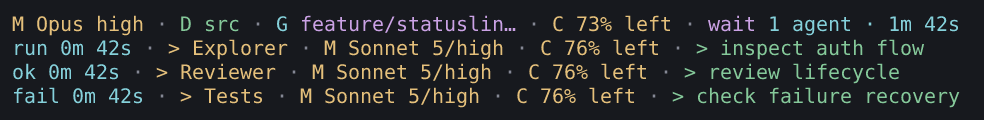

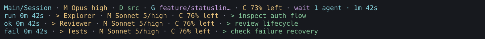

### `agent-focus`

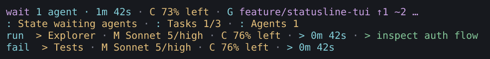

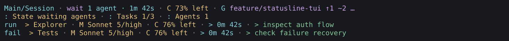

### `quota-watch`

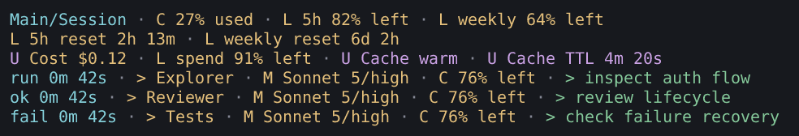

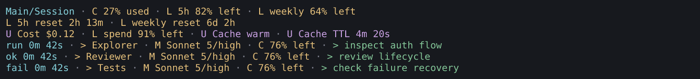

## Optional themes and decorations

Light and dark Powerline examples use English output at 120 columns.

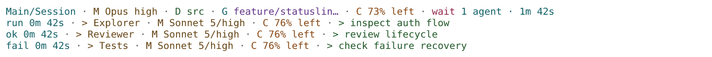

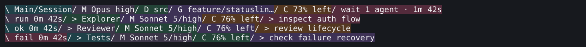

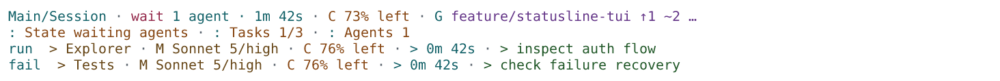

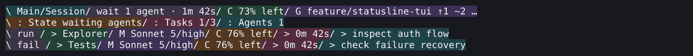

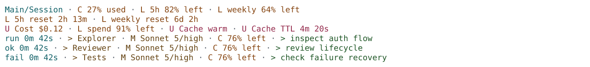

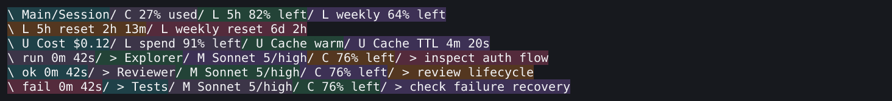

## Missing data and agent states

`agent-focus` emits no subagent rows for no agents or completed-only agents; failed agents remain visible. Each sample is independent fixed input. Missing/expired quota does not become zero; actual zero usage still shows the full remaining allowance.

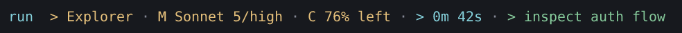

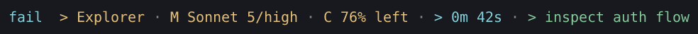

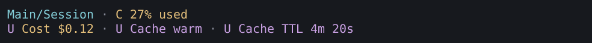


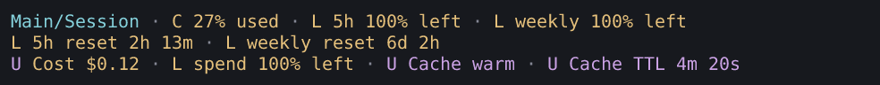

## Setup wizard

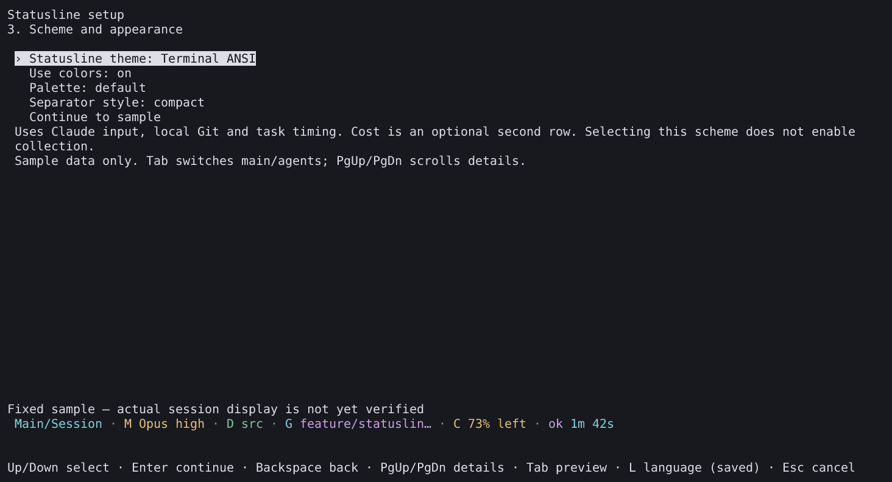

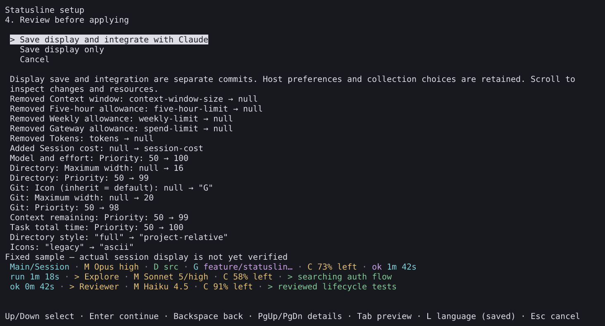

## Reproduction and evidence boundaries

```sh
npm run capture:setup-appearance -- --artifact /absolute/package.tgz \
  --commit FULL_SOURCE_SHA --output /new/capture-directory \
  --font /path/DejaVuSansMono.ttf --font /path/NotoSansCJK-Regular.ttc
npm run capture:editor -- --artifact /absolute/package.tgz \
  --commit FULL_SOURCE_SHA --output /new/editor-directory --extended \
  --font /path/DejaVuSansMono.ttf --font /path/NotoSansCJK-Regular.ttc
```

The tools verify source and package digests. Raw ANSI, cells, inputs and full receipts stay in local ignored acceptance storage. Extended editor captures cover all schemes, Save as, five Powerline controls and narrow screens. Official-host tests and installed native-pane journeys are recorded separately. Image inspection does not substitute for human desktop, suspend or unavailable host-type acceptance.
