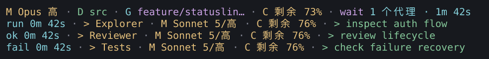
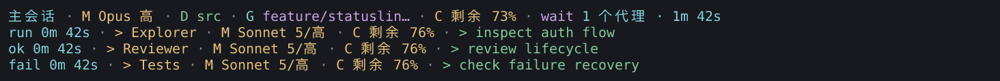
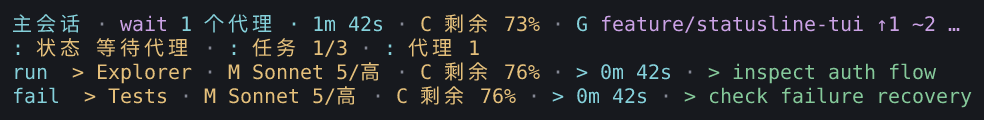
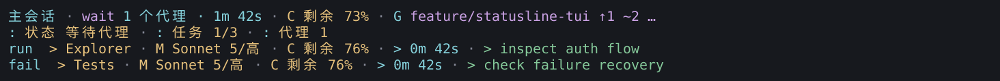
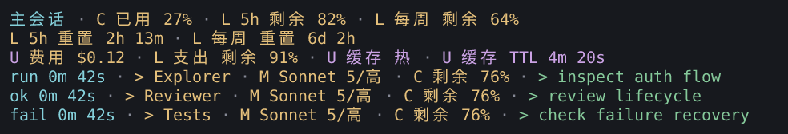
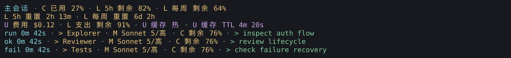
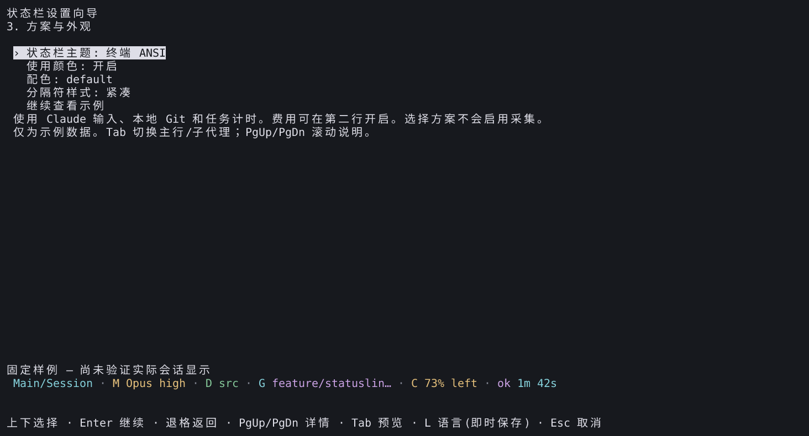
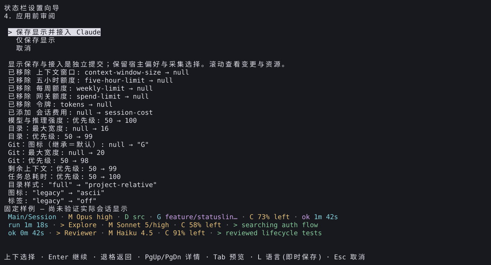

# 设置向导与方案样例来源

[English](README.md) | **简体中文**

以下图片来自隔离安装的 v3.5.0 验收候选包，通过生产渲染器与真实 PTY 采集后重建终端单元格。它们是固定样例，不是操作系统截图、真实账户数据或真人平台验收。发布包的最终身份与复验结果见[交付记录](../../development/setup-appearance.zh-CN.md)。

- 候选源码: `ec0b182ffca7a02e2d0c8523fbacaba52bd8bfae`.
- 安装包 SHA-256: `a9baded89bd7dd28dec520b2bdc5c0fe22c4e47627d3204cf6f028722c9c3cab`.
- 258 项采集收据 SHA-256: `67734eac097e0ea2287167c90fde557c2a7f8e6a88808a559e92b9572515d76d`.
- 覆盖六种语言、80/120 列、浅色/深色/终端主题、三种方案及状态样例。设置向导使用明确标记的合成 Claude 2.1.258 检测结果；所有流程取消后验证文件未改动。
- 字体：DejaVu Sans Mono 与 Noto Sans CJK。图标默认 ASCII；可选 Powerline 示例使用 ASCII 斜线与连续配色，不声称自动检测特殊字体。

最终发行复验使用源码 `7723c540c3e16644b5601b94ce538dcd4ed37d68`，安装包 SHA-256 为 `dc3dd446ec43075c017199c0fc631d89fe46ba7b17d8757917696f3ba22d945b`。258 项捕获再次全部通过，最终收据 SHA-256 为 `107148bcda3bfd19377a54ddda994991d1faa7533228ff31149d5001074c5daa`。已提交的 27 张图库 PNG 与重生成文件逐字节一致；上方候选身份保留图片的原始来源记录。

## 三套方案：80 / 120 列

### `daily-development`





### `agent-focus`





### `quota-watch`





## 可选主题与装饰

浅色与深色 Powerline 示例使用英文输出，均为 120 列。


## 缺失数据与代理状态

`agent-focus` 无代理或仅有已完成代理时没有子代理输出行；失败代理保留。每个样例是独立固定输入。额度缺失和过期不会显示为零；真实零用量仍显示完整剩余额度。


## 设置向导





## 复现与证据边界

```sh
npm run capture:setup-appearance -- --artifact /absolute/package.tgz \
  --commit FULL_SOURCE_SHA --output /new/capture-directory \
  --font /path/DejaVuSansMono.ttf --font /path/NotoSansCJK-Regular.ttc
npm run capture:editor -- --artifact /absolute/package.tgz \
  --commit FULL_SOURCE_SHA --output /new/editor-directory --extended \
  --font /path/DejaVuSansMono.ttf --font /path/NotoSansCJK-Regular.ttc
```

工具核对源码与包摘要；原始 ANSI、单元格、输入和完整收据保留在本地忽略的验收目录。扩展编辑器采集覆盖三套方案、另存副本、五个 Powerline 控件和窄屏；官方宿主测试与实际安装的原生面板旅程另行记录。图像检查不取代真人桌面、休眠或未提供的宿主类型声明验收。
