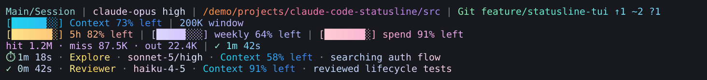
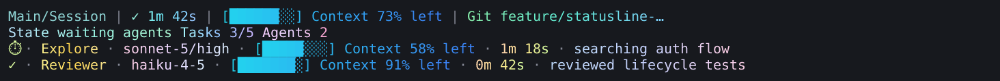
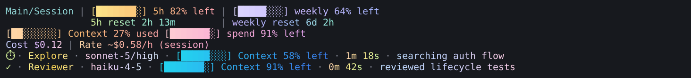
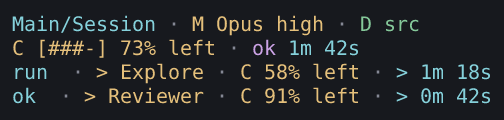
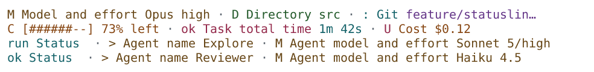
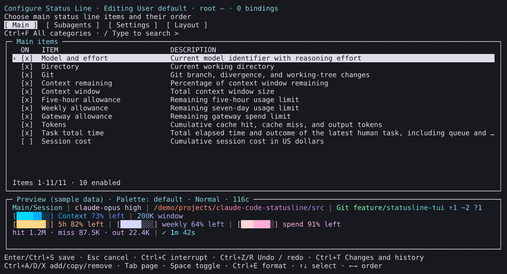
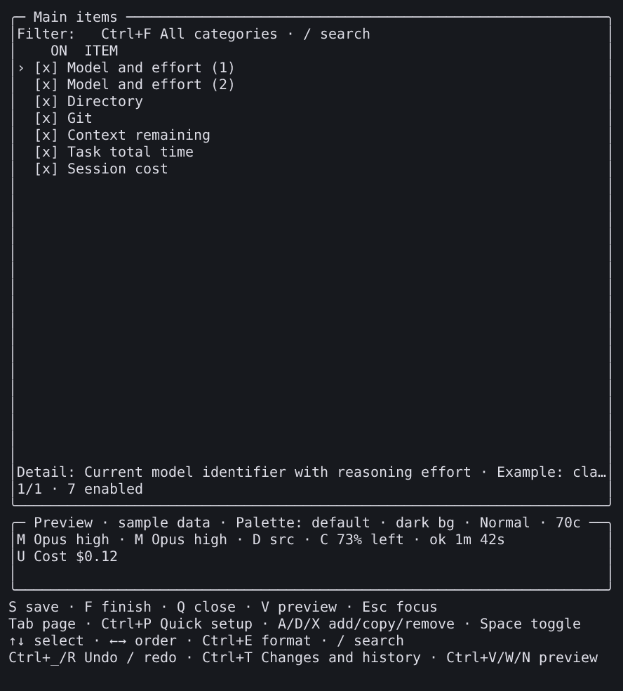
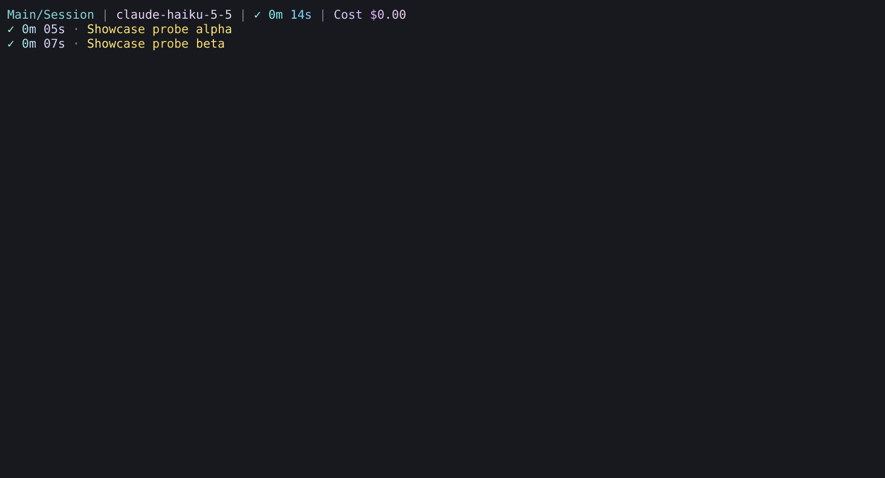
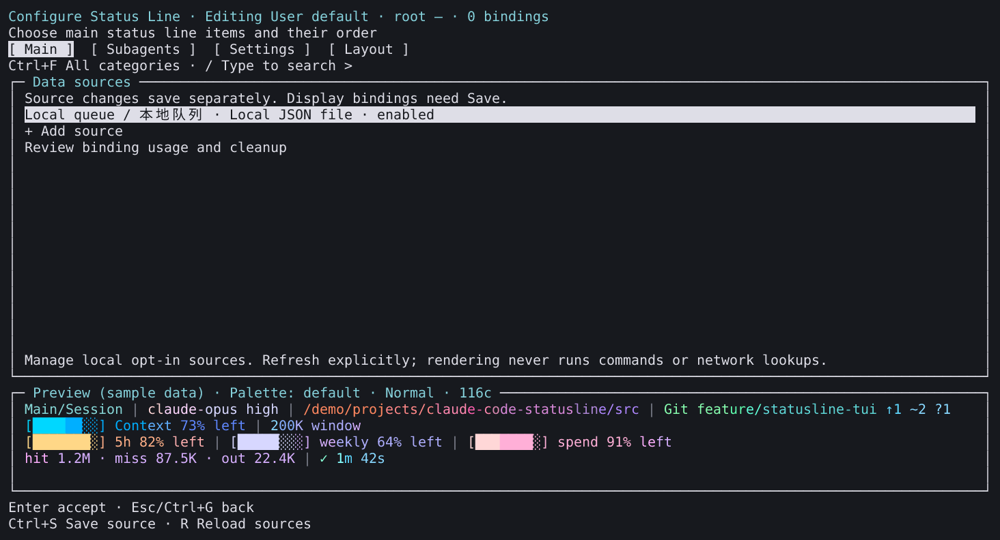
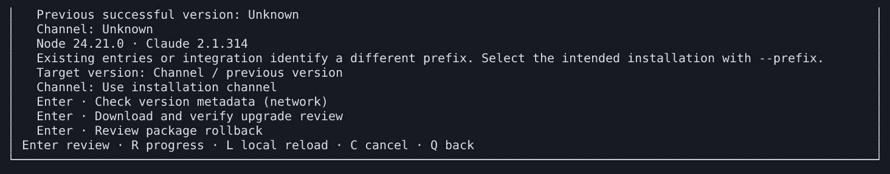

# SHOWCASE-01 gallery

**English** | [简体中文](README.zh-CN.md)

The [walkthrough](../../SHOWCASE.md) reproduces these scenes with published **v3.16.0**. Download the associated profile, inspect it, import it and preview before activation. The approved visual baseline uses classic separators and the default palette, with distinct soft foreground gradients and no Powerline. Dark backgrounds use the Classic theme; light backgrounds use Light. Original model names, legacy formatting and meaningful status symbols remain; extra `M` / `D` / `G` decorations are removed. The [capture inventory](captures.json) records product/collector identity, inputs, method, dimensions, fonts, transformations and file digests; [acceptance](../../development/showcase.md) is separate from the pictures.

The [visual refinement record](../../development/showcase.md#visual-refinement) tracks recollection and verification for all 14 PNGs and six GIFs. It records the new collection's own status and receipts while retaining earlier collection identities. Components share their gradient across scenes and main/subagent rows; the light variant darkens the same hues. See the [formatting baseline](../../SHOWCASE.md#visual-baseline) for the choices behind the profiles.

## Five display scenes

These ten English/Chinese scene images use named fixed observations through the installed production renderer. They do not show actual account usage. The narrow scene is deliberately 40 columns; other selected scenes use their recorded width. See the inventory for dark/light/no-color verification variants.

### Daily development

[Profile](../../../examples/showcase/daily.json) · [Chinese image](zh-CN/daily.png). Derived from `daily-development`, with ten metrics in four rows. Petal for model, Sunset for directory and Ocean for remaining context anchor the shared component colors; session cost is not enabled in this scene.

### Agent workbench

[Profile](../../../examples/showcase/agents.json) · [Chinese image](zh-CN/agents.png). Derived from `agent-workbench`; task and agent timing retain separate scopes.

### Quotas and cost

[Profile](../../../examples/showcase/quota.json) · [Chinese image](zh-CN/quota.png). Derived from `quota-cost`; quota values and threshold colors are samples, not billing evidence. Other ordinary scenes retain their component gradients.

### Narrow terminal

[Profile](../../../examples/showcase/narrow.json) · [Chinese image](zh-CN/narrow.png). Derived from `narrow-terminal`; numeric meaning remains readable as the bar shrinks.

### Light terminal

[Profile](../../../examples/showcase/light.json) · [Chinese image](zh-CN/light.png). Derived from `light-readable`; the same component hues are darkened for a light background with the Light theme and default palette. No Powerline background is enabled.

## Short walkthroughs

The editor clips reconstruct actual installed-editor PTY keyframes. Their colored previews use fixed samples; the controls remain neutral. Each selected frame is held for **1.4 seconds**; the clips are edited walkthroughs, not real-time screen recordings or performance measurements.

### Configure and save

[Chinese clip](zh-CN/configure.gif) · [Steps and cancellation behavior](../../SHOWCASE.md#edit).

This exercise copies the model metric to make Undo and Redo visible, then saves and reopens that draft. The duplicate belongs only to this tutorial. The original daily scene is restored afterward, before the other walkthroughs.

### Reuse and history

[Chinese clip](zh-CN/reuse.gif) · [Style and group reuse](../../DRAFT_HISTORY.md).

### Tasks and subagents

[Chinese clip](zh-CN/tasks.gif) · [Task-viewing steps](../../SHOWCASE.md#tasks).

The task montage has two separately attributed sources: completed-task observations replayed through the installed renderer, then actual viewer PTY frames reading the copied stores. The main task ends at 14 seconds and the agents at 5/7 seconds. It is not the original statusline callback. The viewer retains `active_unknown`, `runtime_disabled` and `incomplete` where observed. The actual CLI session cost is USD 0.00199048; a displayed `$0.00` is two-decimal rounding, not a free-call claim. The [inventory](captures.json) records both sources, transformations and keyframe timing.

## Sources and versions

[Chinese source page](zh-CN/sources.png) · [Source walkthrough](../../SHOWCASE.md#sources).

[Chinese version image](zh-CN/versions.png) · [Version walkthrough](../../SHOWCASE.md#versions). Version controls remain neutral beside the colored preview. Exact bounds and any composition are recorded in the inventory. Choose the intended `--prefix` explicitly when a multiple-prefix warning is present. On the original already-current 3.16.0 installation, the separate dry-run returned `unchanged: true` and `artifact_verified: false`; a colored preview does not establish a newly downloaded archive check.

## Provenance and limits

The public package source is `c89a2ca088099ccd3ceb76baf59ecf11d84b08f0`, with tgz SHA256 `2030ef2f8d386b2fcb1f616fb49ce6f16eed92ec21ea22486799da68151b8c8a`. Collector identities remain separate. Raw private session logs, credentials and preferences are not published; any input sanitization and rendering transformations are recorded.

The visual refinement reuses retained task observations and plans no new paid calls. The original two top-level tasks cost USD 0.00224378 in total according to the CLI; that remains original execution evidence. The earlier gray CLI output inherited `NO_COLOR=1`. Colored recollection removes that inherited setting only from the isolated recording environment; the product's `NO_COLOR` behavior is unchanged.

No picture grants source access or enables collection. Continuous row backgrounds require colored Powerline and are explained in the [appearance guide](../../APPEARANCE.md), outside this gallery's visual choices. Earlier screenshots retain their original files and identities in the [image index](../README.md).

Automated assertions, agent visual inspection, terminal reconstruction and human/physical acceptance are recorded separately. This gallery does not establish a new human usability study; the six existing [issue #96 gaps](https://github.com/fbincon/claude-code-statusline/issues/96) remain unverified.
