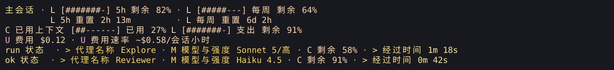
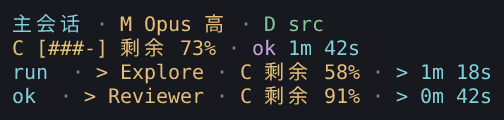
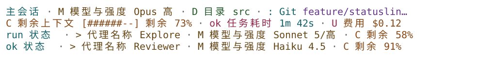
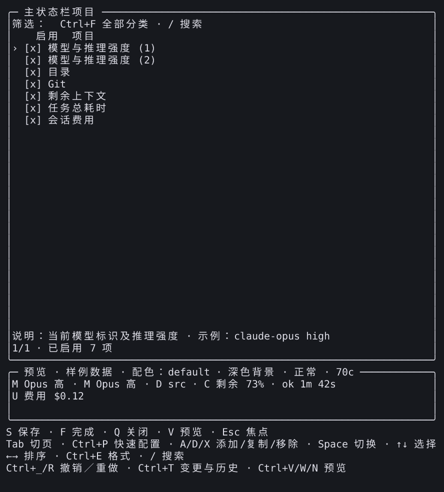
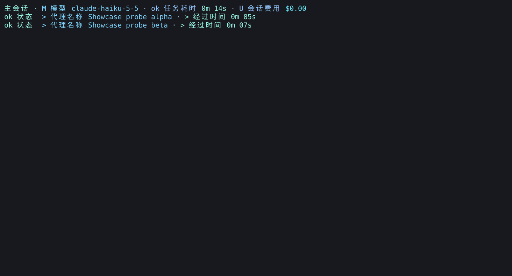
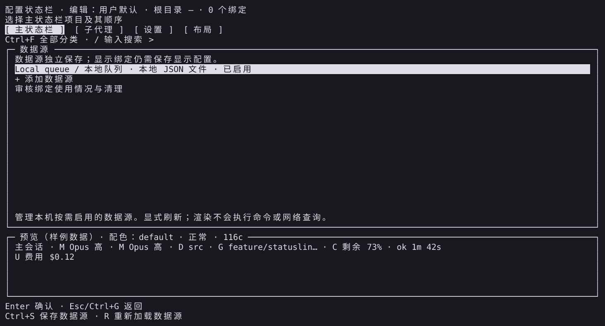
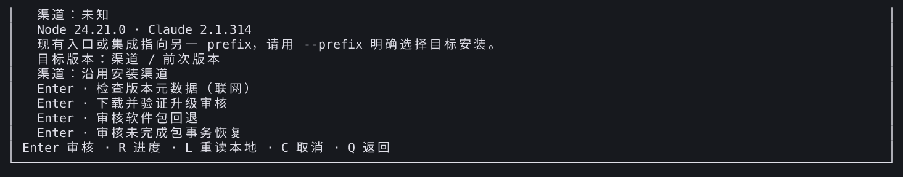

# SHOWCASE-01 图库

[English](README.md) | **简体中文**

[操作指南](../../SHOWCASE.zh-CN.md)使用已发布的 **v3.16.0** 复现这些场景。先下载、检查并导入对应方案，预览后再激活。全部新展示使用紧凑分隔符，不用 Powerline。[采集清单](captures.json)记录产品／工具身份、输入、方式、尺寸、字体、转换及文件摘要；[验收记录](../../development/showcase.zh-CN.md)与图片本身分开。

## 五套显示场景

十张中英文场景图使用已安装生产渲染器处理明确的固定观察值，不表示真实账户用量。窄终端图刻意使用 40 列，其他精选图使用其记录宽度。深色／浅色／无色验证变体见清单。

### 日常开发

[方案](../../../examples/showcase/daily.json) · [英文图片](en/daily.png)。派生自 `daily-development`，使用 Ocean 主题及普通前景渐变。

### 代理工作台

[方案](../../../examples/showcase/agents.json) · [英文图片](en/agents.png)。派生自 `agent-workbench`；任务时间与代理计时保持不同作用域。

### 额度与成本

[方案](../../../examples/showcase/quota.json) · [英文图片](en/quota.png)。派生自 `quota-cost`；额度值是样本，不是账单证据。

### 窄终端

[方案](../../../examples/showcase/narrow.json) · [英文图片](en/narrow.png)。派生自 `narrow-terminal`；进度条缩短时仍保留可读数值含义。

### 浅色终端

[方案](../../../examples/showcase/light.json) · [英文图片](en/light.png)。派生自 `light-readable`，未启用 Powerline 背景。

## 简短操作演示

编辑器动图重建实际已安装编辑器的 PTY 关键帧，预览使用固定样本。每个选中帧停留 **1.4 秒**，属于编辑后的操作演示，不是实时录屏或性能测量。

### 配置与保存

[英文动图](en/configure.gif) · [步骤与取消行为](../../SHOWCASE.zh-CN.md#edit)。

### 复用与历史

[英文动图](en/reuse.gif) · [样式和整组复用](../../DRAFT_HISTORY.zh-CN.md)。

### 任务与子代理

[英文动图](en/tasks.gif) · [任务查看步骤](../../SHOWCASE.zh-CN.md#tasks)。

任务蒙太奇有两个独立归属的来源：先通过已安装渲染器回放完成任务观察值，再接实际查看器读取复制状态的 PTY 帧。主任务结束于 14 秒，代理为 5／7 秒。这不是原 statusline 回调。查看器保留已观察到的 `active_unknown`、`runtime_disabled` 和 `incomplete`。实际 CLI 会话费用为 0.00199048 美元；显示 `$0.00` 是保留两位小数的结果，不是免费声明。[清单](captures.json)记录双方来源、转换及关键帧时序。

## 来源与版本

[英文来源页](en/sources.png) · [来源走查](../../SHOWCASE.zh-CN.md#sources)。

[英文版本片段](en/versions.png) · [版本走查](../../SHOWCASE.zh-CN.md#versions)。本图裁切单元格 `[0,12,120,11]`，不包含完整前缀和当前版本页首。多个前缀的警告是真实诊断，应明确选择目标 `--prefix`。在实际已是当前 3.16.0 的安装中，另行 dry-run 返回 `unchanged: true` 和 `artifact_verified: false`；本图不证明新下载包检查通过。

## 来源与限制

公开包源码为 `c89a2ca088099ccd3ceb76baf59ecf11d84b08f0`，tgz SHA256 为 `2030ef2f8d386b2fcb1f616fb49ce6f16eed92ec21ea22486799da68151b8c8a`。采集工具身份独立保留。原始私有会话日志、凭据和偏好不公开；输入脱敏和渲染转换均记录。

任何图片都不会授予来源权限或启用采集。连续行背景需要彩色 Powerline，见[外观指南](../../APPEARANCE.zh-CN.md)，本图库不采用该视觉选择。旧截图在[图片索引](../README.zh-CN.md)中保留原文件和身份。

自动断言、代理视觉检查、终端重建及真人／实体验收分开记录。本图库不构成新的真人可用性研究；[issue #96](https://github.com/fbincon/claude-code-statusline/issues/96) 的六项既有缺口仍未验证。
