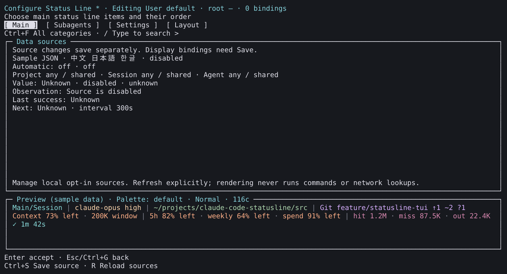
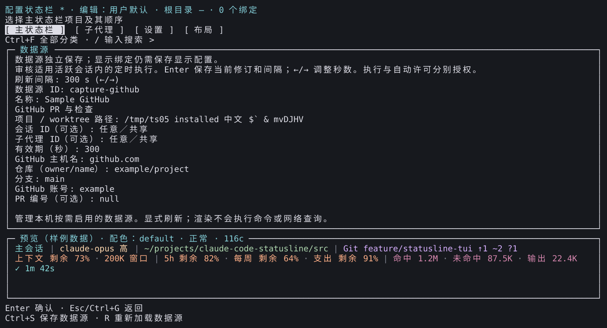

# Source operations captures

**English** | [简体中文](README.zh-CN.md)

These installed Linux x64 PTY cells are reconstructed images, not OS screenshots or physical desktop acceptance. Source: [`d16dacb5b6b937c4f04925b05047dd53538e3206`](https://github.com/fbincon/claude-code-statusline/commit/d16dacb5b6b937c4f04925b05047dd53538e3206); candidate package SHA-256: `42d3c8ad2d98c3be08fbd5adc6080f355cef0aa64cb55f5e2131711bcffcc8fc`. They demonstrate v3.12.0 candidate source pages; final release evidence is tracked separately in [implementation and acceptance](../../development/source-command-package-management.md).

[Provenance](provenance.json) records exact image/cell/ANSI, renderer and font digests. The source is deliberately disabled; the binding inventory is empty. Automatic review uses a GitHub sample and remains unaccepted. No screenshot grants execution permission. Previews use fixed sample data; model calls: zero.

| Page | English | Simplified Chinese |
| --- | --- | --- |
| Readable disabled-source state | [Summary](en-source-summary.png) | [摘要](zh-CN-source-summary.png) |
| Empty binding inventory | [Bindings](en-source-bindings.png) | [绑定](zh-CN-source-bindings.png) |
| Separate automatic-policy review | [Policy](en-automatic-review.png) | [策略](zh-CN-automatic-review.png) |

Reproduce with `npm run capture:editor -- --artifact TGZ --commit FULL_SHA --output NEW_DIRECTORY --font MONO_FONT --font CJK_FONT --extended`. Keep candidate provenance distinct from final release and physical acceptance.
