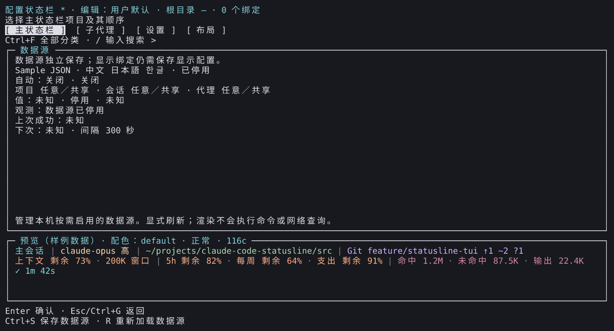
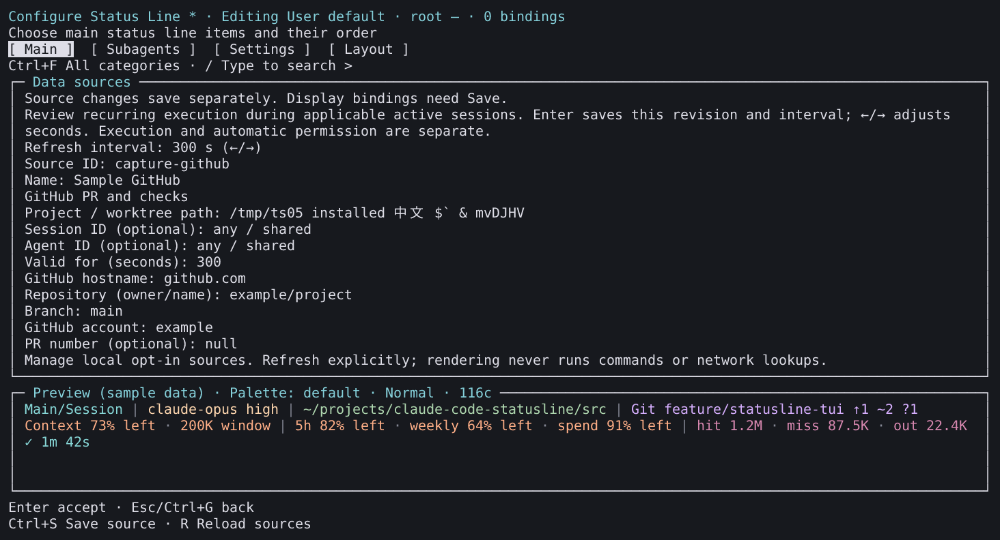

# 来源操作采集

[English](README.md) | **简体中文**

这些图像由安装后 Linux x64 PTY 的实际单元格重建，不是操作系统截图或物理桌面验收。源码：[`d16dacb5b6b937c4f04925b05047dd53538e3206`](https://github.com/fbincon/claude-code-statusline/commit/d16dacb5b6b937c4f04925b05047dd53538e3206)，候选包 SHA-256：`42d3c8ad2d98c3be08fbd5adc6080f355cef0aa64cb55f5e2131711bcffcc8fc`。展示 v3.12.0 候选的来源页面，最终发布证据另见[实现与验收](../../development/source-command-package-management.zh-CN.md)。

[来源记录](provenance.json)保存准确图像／单元格／ANSI、绘制器和字体摘要。数据源刻意停用，绑定清单为空。自动审核采用 GitHub 样例，保持未接受状态。截图不授予执行许可；预览使用固定样例，模型调用为零。

| 页面 | English | 简体中文 |
| --- | --- | --- |
| 可读停用状态 | [Summary](en-source-summary.png) | [摘要](zh-CN-source-summary.png) |
| 空绑定清单 | [Bindings](en-source-bindings.png) | [绑定](zh-CN-source-bindings.png) |
| 独立自动策略审核 | [Policy](en-automatic-review.png) | [策略](zh-CN-automatic-review.png) |

复现：`npm run capture:editor -- --artifact TGZ --commit FULL_SHA --output NEW_DIRECTORY --font MONO_FONT --font CJK_FONT --extended`。候选来源、最终发布和物理验收分别记录。
