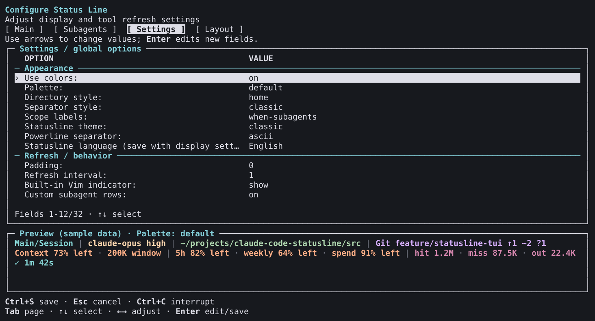

# v3.1.1 installed external editor captures

**English** | [简体中文](README.zh-CN.md)

These 50 selected images reconstruct cells emitted by the installed v3.1.1 external editor in an isolated Linux x64 PTY. They are **not operating-system screenshots** or new human desktop/power acceptance. Earlier TypeScript captures and the [original Python gallery](../../README.md) are preserved.

Source: [`b484dc9acc87bc55a2833904dd332827307603ca`](https://github.com/fbincon/claude-code-statusline/commit/b484dc9acc87bc55a2833904dd332827307603ca). Package: `fbincon-claude-code-statusline-3.1.1.tgz`, SHA-256 `364a0c7fb3c8e7d1715fe5c8d0d5a77e65926bcb3dd6f1c00b3035fb6a73e609`. Node 24.21.0; xterm-256color. [Image, cell, ANSI, collector and font hashes](provenance.json) · [Behavior and delivery evidence](../../../development/external-tui-parity.md).

The complete capture run passed 252 light/dark frames: six languages, four pages, category/picker/search, item formatting, text/numeric input, numeric error notification, guidance and import review. Common views use 120×32; seven boundary sizes are 32×12, 64×18, 64×19, 64×20, 80×24, 120×30 and 80×48. The 50 images below were inspected separately from automated style/behavior assertions. Minimum-size captures show the notice left by cancelling import review and deliberately abbreviated controls.

Dark images preserve the collector's declared rich ANSI palette and original PNG bytes. Light images resolve the **same recorded cells** through the xterm 16-color palette used by contrast assertions, with default foreground `#17191e` and background `#ffffff`. The editor leaves named colors and defaults to the terminal. Provenance distinguishes original capture/PNG hashes, cell-array hashes, reconstruction-input hashes and final image hashes; no captured text or styles are changed.

Production sample previews explicitly use home-relative directories and matching UI/output language. Capture sessions cancel without changing settings/display bytes and restore terminal attributes. No live transcript or model call is used. Images illustrate presentation; separate PTY tests establish save/cancel, interruption, resizing and terminal restoration, while CI establishes installation/runtime coverage.

| Language | Main | Subagents | Settings | Layout | Light settings | 64×18 | Category | Item format |
| --- | --- | --- | --- | --- | --- | --- | --- | --- |
| English | [PNG](en/main.png) | [PNG](en/subagents.png) | [PNG](en/settings.png) | [PNG](en/layout.png) | [PNG](en/settings-light.png) | [PNG](en/boundary-64x18.png) | [PNG](en/category.png) | [PNG](en/detail.png) |
| 简体中文 | [PNG](zh-CN/main.png) | [PNG](zh-CN/subagents.png) | [PNG](zh-CN/settings.png) | [PNG](zh-CN/layout.png) | [PNG](zh-CN/settings-light.png) | [PNG](zh-CN/boundary-64x18.png) | [PNG](zh-CN/category.png) | [PNG](zh-CN/detail.png) |
| 繁體中文（台灣） | [PNG](zh-TW/main.png) | [PNG](zh-TW/subagents.png) | [PNG](zh-TW/settings.png) | [PNG](zh-TW/layout.png) | [PNG](zh-TW/settings-light.png) | [PNG](zh-TW/boundary-64x18.png) | [PNG](zh-TW/category.png) | [PNG](zh-TW/detail.png) |
| 繁體中文（香港） | [PNG](zh-HK/main.png) | [PNG](zh-HK/subagents.png) | [PNG](zh-HK/settings.png) | [PNG](zh-HK/layout.png) | [PNG](zh-HK/settings-light.png) | [PNG](zh-HK/boundary-64x18.png) | [PNG](zh-HK/category.png) | [PNG](zh-HK/detail.png) |
| 日本語 | [PNG](ja/main.png) | [PNG](ja/subagents.png) | [PNG](ja/settings.png) | [PNG](ja/layout.png) | [PNG](ja/settings-light.png) | [PNG](ja/boundary-64x18.png) | [PNG](ja/category.png) | [PNG](ja/detail.png) |
| 한국어 | [PNG](ko/main.png) | [PNG](ko/subagents.png) | [PNG](ko/settings.png) | [PNG](ko/layout.png) | [PNG](ko/settings-light.png) | [PNG](ko/boundary-64x18.png) | [PNG](ko/category.png) | [PNG](ko/detail.png) |

Expanded import review: [English](en/review-expanded.png) · [简体中文](zh-CN/review-expanded.png).

## Settings and item formatting

## Reproduction

Use the fixed source/toolchain and verified package above. Run `npm run capture:editor -- --artifact TGZ --commit FULL_SHA --output NEW_DIRECTORY --font FILE --extended`, repeating `--font` for DejaVu Sans Mono regular/bold, Noto Sans CJK regular/bold and Noto Sans Symbols2. For light gallery reconstructions, add `terminal_palette: XTERM_PALETTE` to the recorded JSON and pass it to `renderCapture` in `tools/acceptance/render-capture.ts`; preserve original cells and raw receipts. [Rendering and validation procedure](../../../development/external-tui-parity.md).

Raw ANSI streams, full cell matrices and private run reports remain in ignored validation output. Public provenance binds each selected image to the fixed release package. These captures do not close the six [version-specific accepted gaps](../../../releases/approvals/v3.1.1.json).
