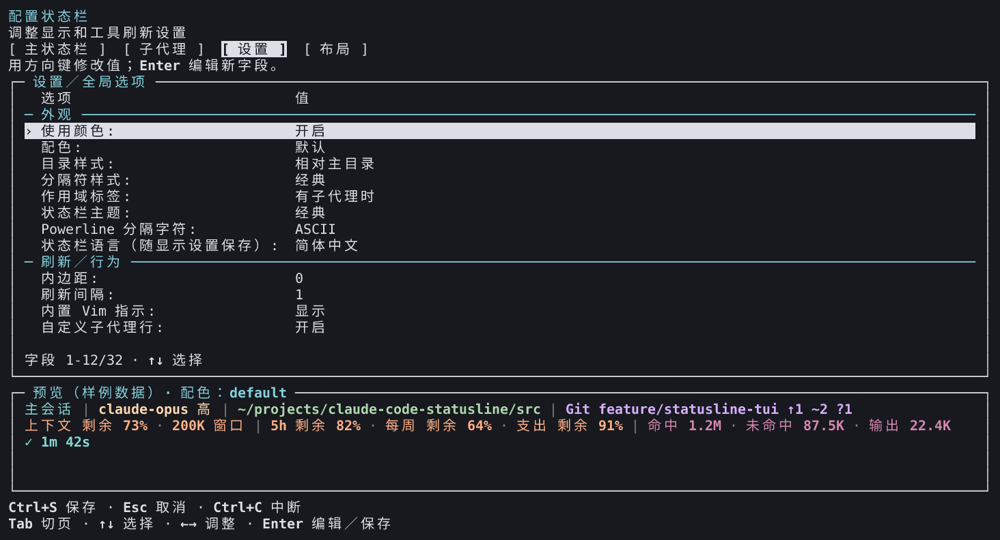
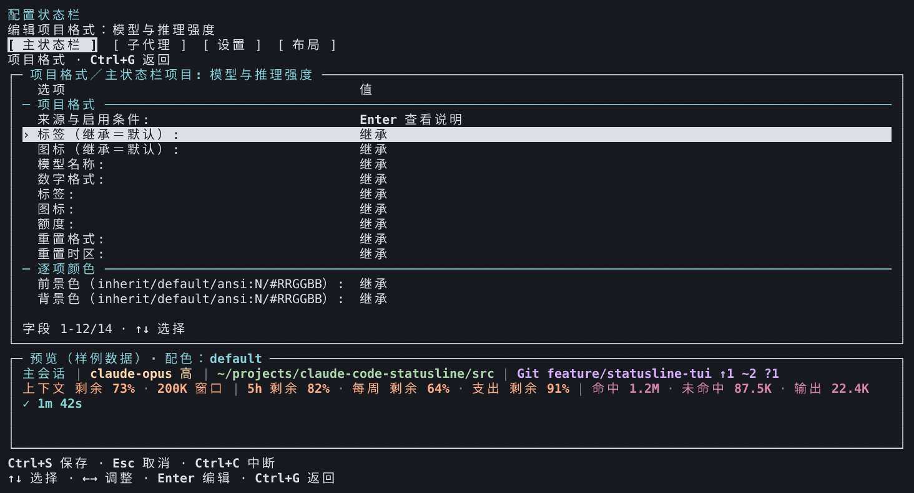

# v3.1.1 已安装外部编辑器图集

[English](README.md) | **简体中文**

这 50 张选图由隔离 Linux x64 PTY 中已安装的 v3.1.1 外部编辑器实际输出单元重建，**不是操作系统截图**，也不构成新增人工桌面／电源验收。此前 TypeScript 图片和[原始 Python 图集](../../README.zh-CN.md)全部保留。

来源提交：[`b484dc9acc87bc55a2833904dd332827307603ca`](https://github.com/fbincon/claude-code-statusline/commit/b484dc9acc87bc55a2833904dd332827307603ca)。安装包：`fbincon-claude-code-statusline-3.1.1.tgz`，SHA-256 为 `364a0c7fb3c8e7d1715fe5c8d0d5a77e65926bcb3dd6f1c00b3035fb6a73e609`。Node 24.21.0，xterm-256color。[图片、单元、ANSI、采集器和字体校验值](provenance.json) · [行为验收与交付证据](../../../development/external-tui-parity.zh-CN.md)。

完整采集通过 252 张明暗帧：六语言、四页面、分类／添加／搜索、项目格式、文本／数字输入、数字错误通知、说明及导入审阅。常规视图为 120×32，七种边界尺寸为 32×12、64×18、64×19、64×20、80×24、120×30、80×48。下列 50 张选图已单独检查，图片检查与自动样式／行为断言分别记录。最小窗口保留了取消导入审阅后的通知，并有意使用缩短的快捷键提示。

深色图保留采集器声明的丰富 ANSI 色板及原始 PNG 字节；浅色图使用对比度断言所用的 xterm 16 色色板解析**相同的记录单元**，默认前景为 `#17191e`、背景为 `#ffffff`。编辑器把命名颜色和默认色的最终映射交给终端。来源记录分别保存原始采集／PNG 校验、单元数组校验、重建输入校验和最终图片校验；未改变采集到的文字或样式。

预览使用生产渲染器的固定样例，明确选择相对主目录显示，并使界面语言与输出语言一致。采集会话取消后，设置／显示配置字节不变且终端属性恢复；不读取真实会话或调用模型。图片说明呈现效果；独立 PTY 测试验证保存／取消、中断、缩放与终端恢复，CI 验证安装和运行时覆盖。

| 语言 | 主状态栏 | 子代理 | 设置 | 布局 | 浅色设置 | 64×18 | 分类 | 项目格式 |
| --- | --- | --- | --- | --- | --- | --- | --- | --- |
| English | [PNG](en/main.png) | [PNG](en/subagents.png) | [PNG](en/settings.png) | [PNG](en/layout.png) | [PNG](en/settings-light.png) | [PNG](en/boundary-64x18.png) | [PNG](en/category.png) | [PNG](en/detail.png) |
| 简体中文 | [PNG](zh-CN/main.png) | [PNG](zh-CN/subagents.png) | [PNG](zh-CN/settings.png) | [PNG](zh-CN/layout.png) | [PNG](zh-CN/settings-light.png) | [PNG](zh-CN/boundary-64x18.png) | [PNG](zh-CN/category.png) | [PNG](zh-CN/detail.png) |
| 繁體中文（台灣） | [PNG](zh-TW/main.png) | [PNG](zh-TW/subagents.png) | [PNG](zh-TW/settings.png) | [PNG](zh-TW/layout.png) | [PNG](zh-TW/settings-light.png) | [PNG](zh-TW/boundary-64x18.png) | [PNG](zh-TW/category.png) | [PNG](zh-TW/detail.png) |
| 繁體中文（香港） | [PNG](zh-HK/main.png) | [PNG](zh-HK/subagents.png) | [PNG](zh-HK/settings.png) | [PNG](zh-HK/layout.png) | [PNG](zh-HK/settings-light.png) | [PNG](zh-HK/boundary-64x18.png) | [PNG](zh-HK/category.png) | [PNG](zh-HK/detail.png) |
| 日本語 | [PNG](ja/main.png) | [PNG](ja/subagents.png) | [PNG](ja/settings.png) | [PNG](ja/layout.png) | [PNG](ja/settings-light.png) | [PNG](ja/boundary-64x18.png) | [PNG](ja/category.png) | [PNG](ja/detail.png) |
| 한국어 | [PNG](ko/main.png) | [PNG](ko/subagents.png) | [PNG](ko/settings.png) | [PNG](ko/layout.png) | [PNG](ko/settings-light.png) | [PNG](ko/boundary-64x18.png) | [PNG](ko/category.png) | [PNG](ko/detail.png) |

展开的导入审阅：[English](en/review-expanded.png) · [简体中文](zh-CN/review-expanded.png)。

## 设置与项目格式

## 复现

使用上述固定源码、工具链和已验证安装包。运行 `npm run capture:editor -- --artifact TGZ --commit FULL_SHA --output NEW_DIRECTORY --font FILE --extended`，重复 `--font` 指定 DejaVu Sans Mono 常规／粗体、Noto Sans CJK 常规／粗体和 Noto Sans Symbols2。浅色图库重建在记录 JSON 中添加 `terminal_palette: XTERM_PALETTE`，再交给 `tools/acceptance/render-capture.ts` 的 `renderCapture`；保留原始单元和采集凭据。[绘制与验证流程](../../../development/external-tui-parity.zh-CN.md)。

原始 ANSI、完整单元矩阵和私有运行报告放在被忽略的验证目录中。公开来源记录将每张选图绑定到固定发布包；这些图片不关闭六项[本版接受的既有缺口](../../../releases/approvals/v3.1.1.json)。
