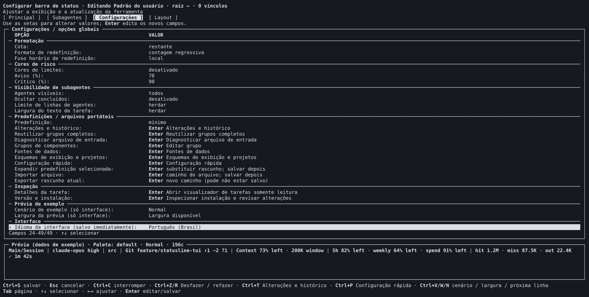
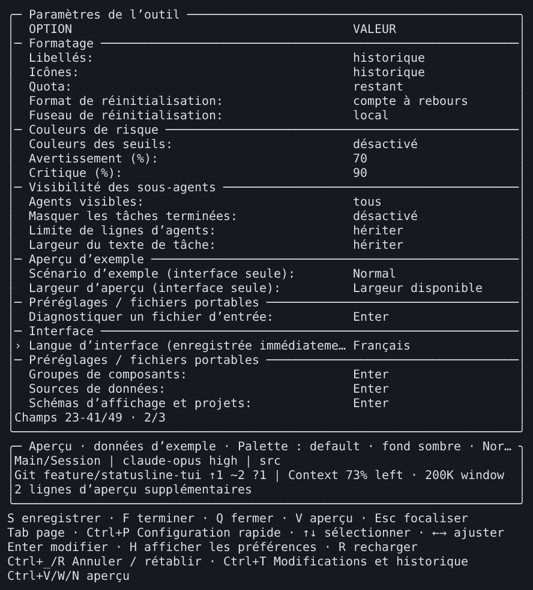
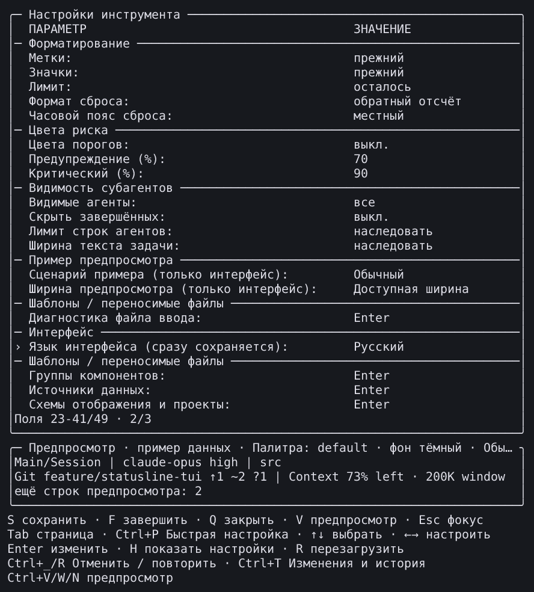

# v3.16.0 language editor captures

**English** | [简体中文](README.zh-CN.md)

These nine images reconstruct cells emitted by the installed v3.16.0 candidate in an isolated Linux x64 PTY: six external Settings frames and three Native Settings frames. Every PNG was inspected separately from the automated behavior checks. They are terminal reconstructions, not operating-system screenshots or new human desktop/power acceptance.

Captured on 2026-10-30 from source [`6e86031ff1bfeb900c9c38dee58ca10194ab936d`](https://github.com/fbincon/claude-code-statusline/commit/6e86031ff1bfeb900c9c38dee58ca10194ab936d). Candidate package: `fbincon-claude-code-statusline-3.16.0.tgz`, SHA-256 `6d6d955e3850e25c36705927e97ba8522d0bde83d60f1de32b8d229458501b68`. This capture identity remains unchanged by later documentation or release commits. [Image, cell, collector, renderer, font and verification hashes](provenance.json) · [Language-expansion delivery record](../../../development/language-expansion.md).

| Language | External Settings | Native Settings |
| --- | --- | --- |
| Español | [PNG](external/es/settings.png) | — |
| Français | [PNG](external/fr/settings.png) | [PNG](native/fr/settings.png) |
| Deutsch | [PNG](external/de/settings.png) | — |
| Português (Brasil) | [PNG](external/pt-BR/settings.png) | — |
| Русский | [PNG](external/ru/settings.png) | [PNG](native/ru/settings.png) |
| Bahasa Indonesia | [PNG](external/id/settings.png) | [PNG](native/id/settings.png) |

## Capture boundaries

The environment was Node 24.21.0, Claude Code 2.1.312, editor protocol 31 and an `xterm-256color` terminal at 200×50 cells. External images retain the whole viewport, producing 2424×1224 pixels. Native images crop the 72×40 editor region at zero-based coordinates `(128, 4)`, producing 888×984 pixels. The crops retain Settings, sample preview and all footer rows while excluding the host transcript, composer, actual host statusline and private paths.

The interface language is independent of the sample-output language. These Settings captures deliberately retain English output while each selected interface language is visible. Samples use the production preview renderer with fixed observations and a basename-only directory. They do not show live account usage. Long labels and preview headings retain the editor's existing whole-grapheme clipping and ellipses.

Recorded text and styles are unchanged. Reconstruction uses the declared dark terminal defaults (`#dedee7` foreground, `#17191e` background), the renderer's rich ANSI palette, DejaVu Sans Mono regular/bold, Noto Sans CJK regular/bold and Noto Sans Symbols2. These are explicit analysis fixtures, not measurements of a physical terminal profile.

## Verification scope

The same candidate passed an exact 1,092-file installed inventory and six editor journeys: cancel, save and restore in each frontend. Each frontend's cancel journey cycled all twelve interface languages, checked localized catalog search and meaningful production previews, and verified immediate interface persistence independently of the display draft. Native also checked the localized display-scheme/project and version/installation entry captions in every language. Save, reopening, readback and cancellation were checked; all six journeys restored terminal attributes.

Nine isolated preference paths were restored with their original bytes, modes and absence state. Separate read-only CLI checks verified all twelve output languages at 40/80/120 columns for main and subagent rows: 72 cases, plus the configured statusline command. The fixture was removed after success. The Native child used synthetic authentication inside a verified network namespace without outbound routes; recorded model request attempts and model calls were both zero.

These installed PTY observations and the nine agent-inspected images are separate from the full UI/output combination matrix, official-host capacity tests, platform installation checks and human physical acceptance. No native-speaker review is claimed. The six accepted [issue #96 gaps](https://github.com/fbincon/claude-code-statusline/issues/96) remain unverified; release identities and required CI gates are recorded in the delivery record above.

## Examples

## Reconstruction and history

Use the verified source, package, captured cell matrix and five recorded fonts with the canonical `tools/acceptance/render-capture.ts` renderer. Its compiled entry accepts `CAPTURE_JSON OUTPUT_PNG --commit FULL_SHA --bounds X,Y,WIDTH,HEIGHT --font FONT`; repeat `--font` for all five files. Use bounds `0,0,200,50` for external images and `128,4,72,40` for Native images. The one-off PTY driver, raw ANSI, complete cells, synthetic host configuration and restoration snapshots remain in ignored private validation output; they are not included in a repository clone. Public provenance contains hashes and the selected-image metadata, without private absolute paths or transcripts.

The [earlier six-language gallery](../v3.1.1/README.md), [regional gallery](../regional/README.md) and [historical Python language captures](../../languages/README.md) retain their original images and evidence.
